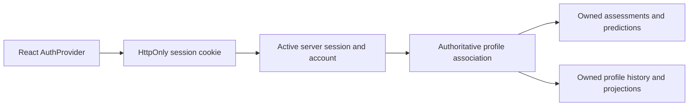

# Authentication architecture and implementation planning — Phase 29.6.1

> Historical snapshot: the original phase dates, design decisions and recorded
> test results below are preserved. Statements about the then-current inventory,
> unavailable features and pre-authentication behavior are superseded by the
> [reviewed 2026-11-24 release snapshot](../backend/DEPLOYMENT.md#reviewed-release-snapshot-2026-11-24).
> This documentation change reruns no application tests and establishes no new
> Linux/Docker or browser acceptance.

Designed 2026-11-08 against the current working tree on `bhargav-frontend`, HEAD
`f84099349d104e4e77c7080fba4465ca4e3470a4`. **Documentation only: none of the accounts,
cookies, dependencies, routes, tables, ownership checks or retry changes proposed
here exists yet.** No historical record or production source was changed.

## 1. Executive summary

Use immutable accounts, opaque server sessions delivered by Secure HttpOnly cookies,
and one authoritative server-controlled account-to-profile association. Allow an
account to deliberately own multiple profiles; revisions change content, never
ownership. Protect all 20 private application operations, including direct form
inference and upload processing. Keep health and the two public company reads public.
There is no public student-readiness endpoint.

Preserve existing JSON profiles, assessment sessions, IDs, results and history.
Recommend a small separate SQLite metadata store using the existing stdlib capability
for future accounts/sessions/associations/retry metadata. It must not replace the
company database or migrate student JSON. Cross-file publication needs explicit
accepted-intent recovery; SQLite does not make JSON writes transactional.

Existing legacy records remain unowned and inaccessible through future account APIs.
A separately approved institutional association process may later add auditable
mappings without changing historical IDs. Email equality, UUID possession, profile
confirmation and browser flags cannot claim a record.

Implement the staged roadmap below with one final release gate. Completing a stage
does not make a partly protected system safe for external student use. No stage
29.6.2 or later begins in this design phase.

## 2. Current limitations and source verification

Read [the reviewed release snapshot](../backend/DEPLOYMENT.md#reviewed-release-snapshot-2026-11-24), [root setup guide](../README.md),
[29.5 ownership audit](ownership-access-control-audit.md), [29.4 integration report](frontend-backend-integration.md),
[revision policy](profile-revision-integrity.md), [resume integrity policy](resume-evidence-integrity.md)
and [skill evidence policy](skill-evidence-policy.md). Earlier journal results are
historical evidence, not new tests in this phase.

Source inspection covers all nine routers and main, schemas, profile/assessment
transactions, recovery, evidence and histories, shared projections and prediction
services, resume processing, frontend mock login, API transport, profile selection,
resource/draft controllers, browser storage and existing regression functions.
Static AST inventory finds **23 operations / 22 paths**, matching Phase 29.5. No
application authentication/authorization dependency, account model or owner registry
is present. This phase does not rerun the earlier synthetic exploit tests.

| Current mechanism | Actual behavior and required future boundary |
| --- | --- |
| Profile creation | From-resume generates UUID after extraction/analysis. Verify can create without ID or with an absent acceptable client-chosen ID. No account association or creation key. |
| Confirmation/email | `verified` confirms claims. Name/email are required but unverified; matching contact emails never establish account identity. |
| Profile revision/update | Atomic replacement and local locks; optional expected revision; exact repeats harmless, stale conflicting guarded edits 409. Protected originals/evidence/history are restored from the server. |
| Assessment | Start reserves quota; stored state is IN_PROGRESS. Submit checks two supplied/stored profile IDs, not a participant. GET/history run `_sync_sessions` and can expire/recover other sessions on that profile. |
| Histories | Assessment evidence and placement history live on profile JSON; sessions retain their profile link. New predictions include source revision/inputs; legacy source remains unknown. |
| Prediction | Profile POST supports a profile-scoped key. Direct placement and salary are stateless form requests; no server profile-linked salary history. |
| Shared derived output | Readiness, skills, eligibility, recommendations, summary and performance use current server profiles/evidence; source revision supports freshness, not ownership. Dashboard composes these APIs; no extra dashboard route. |
| Resume | Upload/analyze use temporary binaries and return extraction; existing-profile review does not automatically apply it. No stored binary-resume download route. |
| Browser | `placepro_authenticated` is a mutable mock flag. Provider mounts/fetches before mock login. Profile ID/default and drafts are browser-selected; mock logout leaves private mirrors/answers. |
| CORS/configuration | Main permits wildcard origins/methods/headers with credentials. Installed Starlette reflected arbitrary Origin in 29.5. Defaults are HTTP 127.0.0.1:5173/8765; backend does not load .env. |

Source comments claiming model readiness or session ownership are broader than the
executed checks. Health is static liveness. UUID/path validation prevents malformed
paths but does not authorize access. The prior audit demonstrated anonymous private
reads/modifications/session submission and retry gaps on synthetic records; those
risks still exist. No new penetration, browser or real-student experiment is claimed.

## 3. Recommended authentication architecture

Choose an opaque server session for the first-party browser and single FastAPI
backend. Cookie contents identify a server session, not an account claim or profile.
Every private operation resolves an active account and checks a current association.
Never trust `account_id`, `owner_id`, profile contact data or frontend page guards.



| Option | Suitability |
| --- | --- |
| Opaque server session + HttpOnly cookie | Recommended: immediate revocation/account lookup and simple first-party transport; requires CSRF and reliable metadata persistence. |
| JWT bearer | Useful for future non-browser/multi-service consumers; adds signature/issuer/audience/expiry and revocation concerns. In-memory bearer still has XSS exposure; ownership must still be read server-side. |
| JWT cookie | HttpOnly prevents token reading but does not remove CSRF or stale permissions; logout/recovery still need server state. No present simplification. |
| Short access JWT + rotating refresh token | Token-family replay and concurrent refresh handling add complexity; defer until deployment/client requirements justify it. |
| Starlette signed cookie session | Signed data is readable, not encrypted; it is not the chosen opaque revocable session store. Do not put profiles/permissions in it. |

If institutional OIDC with supported recovery is available, evaluate it before local
password implementation; use validated issuer/audience/signatures/state/nonce and
authorization code PKCE, then issue the same application session. No provider exists
today. This plan otherwise assumes local email/password accounts with verified email
and working recovery delivery before release; no fake social-login substitute.

## 4. Account and session data design

These are proposed logical records, not applied SQL or a migration. Use parameterized
queries, unique constraints and short explicit transactions. Store metadata in a
dedicated private file (proposed `PLACEPRO_AUTH_DB`), never the public company DB.
No new ORM or database technology is required. Its exact location/configuration is
a future setup decision; all tests must override it before application import.

| Record | Proposed fields/constraints | Purpose |
| --- | --- | --- |
| Account | Server UUID `account_id` PK; `email_normalized` UNIQUE; optional display email; encoded `password_hash`; status PENDING_EMAIL/ACTIVE/DISABLED/DEACTIVATED; email_verified_at; auth_version; created_at/updated_at/password_changed_at | Identity and revocation authority; no profile PII/history copied here. |
| Session | Random record ID; UNIQUE hash of 256-bit secret token; account FK; issued_at/last_seen_at/idle_expires_at/absolute_expires_at; issued_auth_version; revoked_at; CSRF secret/token hash; optional user-chosen device label | A separate login session per browser cookie context. No raw session secret persisted. |
| Profile association | `profile_id` UNIQUE; account FK; PENDING/ACTIVE/SUSPENDED state; linked_at; origin NEW_PROFILE/APPROVED_LEGACY; association operation/reference | One active owner per profile. No student self-transfer/sharing endpoint in this scope. |
| Email/recovery challenge | Random token hash, account/purpose, issued_at/expires_at/consumed_at; attempt/send limits | Single use, purpose-bound; reset and email verification are different capabilities. |
| Retry intent | Account FK, operation, resource/scope, key UNIQUE in scope; normalized payload fingerprint; source revision or null; version; state; stable result/reference; accepted_at/expires_at | Account-bound operation identity; not another assessment score/history store. |
| Security audit event | Event ID/time, actor/account reference where known, action/outcome/correlation reference, minimal association reference | Login/revocation/approved association evidence; no passwords/tokens/answers/profile bodies. |

Do not duplicate ownership in editable profile JSON or browser storage. Assessment
ownership is derived from its immutable stored profile link and that association.
Optional actor/source revision metadata for future operations belongs to the accepted
intent/new record only; do not backfill missing historical owners or revisions.

Email policy proposal: support conventional ASCII local parts and validated IDNA
domains first; trim surrounding email whitespace, lowercase domain and ASCII local
part for the documented case-insensitive account key. Do not remove dots or plus
suffixes or apply provider-specific aliases. Unsupported international local parts
receive a clear validation error pending an explicit policy. Contact email on a
profile is independent and never changes the account login address or association.
Choose/test the validation library and wheel support in 29.6.2, without changing
existing resume/profile parsing. Email identity is unique by this explicit policy,
not a claim that all mail servers treat local parts identically.

Registration creates a pending account and email challenge under a uniqueness
constraint. Concurrent/repeated normalized emails cannot create two accounts or
replace an existing hash. Proposed anonymous response is generic 202 for new/duplicate
registration and reset requests; disclose no account ID/status. Verification activates
that account only. Login requires correct password, ACTIVE status and verified email;
return generic 401 for invalid/pending/disabled credentials with comparable hash work.
Enrollment failure/retry must not trap an address or overwrite an active account;
resend/restart policy must require mailbox control and bounded challenges.

### Proposed new API contracts (not existing endpoints)

| Contract | Access and behavior |
| --- | --- |
| GET `/api/auth/csrf` | Exact-origin bootstrap; minimal short-lived pre-login cookie/challenge if anonymous, or current session CSRF token. No account/profile data. Not proof of login. |
| POST `/api/auth/register` | Pre-login CSRF/Origin + rate limits; generic 202; no session/private profile until email verification. |
| POST `/api/auth/email/verify` | Purpose-bound single-use token, CSRF/Origin; activates account without claiming legacy profiles. |
| POST `/api/auth/login` | Pre-login CSRF/Origin, bounded credential verification; new cookie/session only after durable persistence. |
| GET `/api/auth/me` | Active session; minimal account ID/display email/status and expiry; 401 otherwise. No password hash/session token in JSON. |
| POST `/api/auth/session/renew` | Active session + CSRF; explicit single-flight renewal within fixed absolute expiry. |
| POST `/api/auth/logout` | CSRF/Origin; revoke current token durably before reporting success/clearing cookie; safe repeated logout 204. |
| GET `/api/auth/sessions` | Active session; own session labels/timestamps only, never token hashes. |
| POST `/api/auth/sessions/{session_id}/revoke` | Active account + own session association + CSRF; foreign/missing 404; support logout-all with re-authentication. |
| POST `/api/auth/password/change` | Active session + current password/re-authentication + CSRF; update hash/auth_version and revoke sessions in one metadata transaction. |
| POST `/api/auth/password/reset-request` and `/reset-confirm` | Request is generic 202 and bounded; confirmation consumes valid challenge, updates hash/version and revokes sessions atomically, with CSRF/Origin. No automatic login. |
| GET `/api/account/profiles` | Active account; minimal ACTIVE owned profile references. Never return unowned IDs or scan/show foreign profile contents. |

Future active-assessment discovery may add an owned, CSRF-protected profile session
reference endpoint in 29.6.8. Read canonical session JSON rather than creating a
second status/score source. Account-address change, sharing/staff permissions and
physical deletion are separate scopes with re-authentication and explicit approval.

## 5. Profile ownership and publication

Relationship: **Account -> owned profiles -> assessment sessions, evidence,
placement history and private projections**. Multiple deliberate profiles are
allowed; a new resume is not silently merged into another record. An optional
primary-profile preference must reference an ACTIVE owned association.

Create new profile identity server-side and reserve a PENDING association/accepted
creation intent before any resource can be published. Validate extraction/claims
first; persist the stable-ID JSON under existing locks; only then publish the
association ACTIVE after verifying its durable target. Do not call today's helper
that generates a second UUID on each retry without adapting it to a reserved ID.
If any stage fails, return pending/error and retain accepted identity for recovery;
do not report creation success, expose a pending JSON through ordinary APIs or retry
with another ID. Recovery verifies intent/payload and cannot overwrite newer edits.

Existing `POST /api/profile/verify` requires careful branching: absent body ID is an
account-bound new creation with server UUID; supplied ID must already be owned (or
be the caller's reserved creation identity). Missing/foreign/legacy supplied IDs
return 404 and must not fall back to client-chosen creation. This intentionally
tightens the current absent-ID-in-storage behavior; preserve the path/response shape
and existing owned draft confirmation. Never infer the branch by email matching.

Ownership checks first read association metadata, not canonical profile content.
Then, under profile locks, reload the owned target and run existing revision and
confirmation guards. Require reviewed revision on authenticated PUT/confirmation;
document deliberate removal of the weaker revision-less client path, preserving
exact replay and 409 semantics. Ignore/reject spoofed owner/protected body fields
without letting them alter server metadata, originals, scores or histories.

Ownership stays unchanged when name/email, skills, confirmation or revision changes.
Existing-profile uploads remain read-only analyze plus explicit correction/confirmation.
New profile picker uses only owned references; a stale stored selection absent from
that set is cleared, never requested or claimed. Account IDs are never profile IDs.

### Authorization ordering and concurrency

1. Match the private/public request policy; validate active cookie/session/account.
2. Check CSRF/Origin where required, before accepted-intent or domain mutations.
3. Validate target syntax; look up association and permission. Session routes use a
   non-mutating metadata read of their stored profile link, then check association.
4. Acquire existing profile-before-session locks; recheck target association/session
   version at mutation acceptance; reload domain data and check revision/limits.
5. Look up/reserve the caller's retry identity only after authorization; perform
   accepted operation/recovery, preserve protected fields, return private result.

Some internal reads are necessary to resolve a session link; never return its data
or call public `get_assessment` for that discovery. It invokes recovery before an
ownership check. Do not change lock order: release an initial session read lock
before acquiring the profile lock, then acquire session lock as needed. No ordinary
user ownership-transfer API means associations are stable; later suspension/change
needs the same cooperating lock and acceptance ordering.

Revocation and acceptance must have defined ordering: a short metadata transaction
checks current auth_version/session status and records mutation acceptance. If
revocation wins first, no new domain work is accepted. Work already durably accepted
may finish/recover after logout; do not cancel it by erasing evidence. A read/response
already sent cannot be recalled. Client auth-generation guards discard late data.
Do not hold a SQLite transaction while running inference/upload parsing. Failure
between acceptance and JSON publication is recoverable, not crash-atomic across stores.

## 6. Legacy record protection

| Approach | Advantages | Disadvantages/risks | Decision |
| --- | --- | --- | --- |
| Unowned, inaccessible through user APIs | No wrong attribution, no record rewrite; explicit fail-closed boundary | Historical users cannot immediately self-access; needs recovery/support policy | Required default at auth cutover. |
| Separately approved association process | Can restore access after institutional evidence/conflict review | Wrong mapping exposes full linked history; needs restricted backup/rollback and audit | Future explicit assignment only; no public claim-by-email/ID endpoint. |
| Auditable account/profile mapping | Preserves IDs, session/history references and original bytes; supports permission review | Mapping durability/ACLs and rollback are security-critical; not a substitute for ownership evidence | Proposed authoritative association store; approve each legacy import separately. |

No automatic assignment to a newly verified email account. No merge, renumbering,
deletion, anonymization or source-revision fabrication. Existing old associations
remain unknown, not retroactively asserted by a new actor field. Legacy lifecycle
requests must be denied before lazy numbering repair, expiry or evidence recovery.
There is no legacy-anonymous compatibility exception at release.

Any later association plan must privately enumerate necessary reference metadata,
establish approved institutional evidence, review conflicts/orphans, obtain explicit
mapping approval, retain restricted backups and a revocable audit trail, test synthetic
dry runs and reference invariants, and define rollback of **associations only**.
Never roll history JSON backward to undo an ownership decision. Account deactivation
revokes access but preserves records; physical deletion/export/retention requires a
distinct approved lifecycle policy. No association or migration occurs here.

## 7. Complete backend authorization matrix

**Future policy**, not today's behavior. All 23 existing operations currently lack
AuthN/AuthZ. Auth means ACTIVE verified account + live server session. P means owned
profile; S means resolve stored assessment link and verify P, not equality alone.
R/W describe input/storage reads and durable domain writes (transient parsing is
labeled separately). Company reads can initialize/seed SQLite; lock bookkeeping is
not a student write. Cross-account responses assume valid credentials/CSRF and target
another account's resource. Invalid CSRF is 403 without object disclosure; absent,
expired or revoked authentication is 401. Foreign/missing/unowned resources share
404. Allowed domain validation retains 400/422/409/410/429/503.

Check codes: **A** active account; **P** current association before profile read;
**S** non-mutating session link then P; **C** CSRF + exact Origin; **N** account-bound
creation/publication; **Q** bounded account parsing/inference. For all private POST/PUT
use C, including stateless inference; lifecycle GETs also require C because they can
mutate. Test references below are inspected existing tests, not future auth passes.

| Method | API path | Auth | P | S | Reads / writes | Anonymous | Cross-account | Required check | Existing regression |
| --- | --- | --- | --- | --- | --- | --- | --- | --- | --- |
| GET | `/health` | No | No | No | R static / W none | 200 | 200, no student context | Public static liveness; no auth/storage secrets | T1 |
| POST | `/api/predict` | Yes | No target | No | R submitted form/model / W none | 401 | N/A; own form allowed | A+C+Q; no supplied ID creates history | T2 |
| POST | `/api/salary-predict` | Yes | No target | No | R submitted form/model / W none | 401 | N/A; own form allowed | A+C+Q; supported model inputs unchanged | T2 |
| POST | `/api/resume/upload` | Yes | No target | No | R upload / W new transient file only | 401 | N/A; caller's supplied upload only | A+C+Q before parsing; no stored-resume lookup | T3 |
| POST | `/api/resume/analyze` | Yes | No target | No | R upload / W new transient file only | 401 | N/A; independent preview only | A+C+Q; add P if a target is introduced later | T3 |
| POST | `/api/profile/from-resume` | Yes | New owner | No | R upload / W draft + association/intent | 401 | Creates caller's profile only | A+C+Q+N; source IDs never accepted as ownership | T3 |
| POST | `/api/profile/verify` | Yes | Existing target; new owner otherwise | No | R body/owned profile / W claims/confirmation or new profile | 401 | Supplied foreign/unknown ID 404 | A+C+P or N; no missing-ID fallback; reviewed revision | T4 |
| GET | `/api/profile/{profile_id}` | Yes | Yes | No | R canonical/originals/history / W none | 401 | 404 | A+P before JSON; minimal private response | T5 |
| PUT | `/api/profile/{profile_id}` | Yes | Yes | No | R body/profile / W claims/revision | 401 | 404 | A+C+P; path/body consistency; revision; protected fields | T4, T6 |
| POST | `/api/profile/{profile_id}/predict` | Yes | Yes | No | R profile/model/history / W prediction history | 401 | 404 | A+C+P+Q before key lookup; source revision | T7 |
| GET | `/api/profile/{profile_id}/readiness` | Yes | Yes | No | R profile/evidence / W none | 401 | 404 | A+P; retain confirmation/evidence policy | T5, T8 |
| GET | `/api/profile/{profile_id}/placement-summary` | Yes | Yes | No | R profile/model/evidence / W none | 401 | 404 | A+P+Q; retain read-only history behavior | T5, T9 |
| GET | `/api/companies` | No | No | No | R public requirements / W first-use seed only | 200 | 200 | Deliberate public projection; no student or future staff metadata | T10 |
| GET | `/api/companies/{company_id}` | No | No | No | R public requirements / W first-use seed only | 200/404 | 200/404 | Public known/missing company semantics | T10 |
| GET | `/api/profile/{profile_id}/eligibility` | Yes | Yes | No | R profile/public requirements / W seed only | 401 | 404 | A+P before profile read or company initialization | T5, T8 |
| GET | `/api/profile/{profile_id}/eligibility/{company_id}` | Yes | Yes | No | R profile/public requirements / W seed only | 401 | 404 | A+P before domain company lookup | T5, T8 |
| GET | `/api/profile/{profile_id}/recommendations` | Yes | Yes | No | R profile/model/requirements / W seed only | 401 | 404 | A+P+Q; one current evidence snapshot | T5, T8 |
| POST | `/api/assessment/start` | Yes | Yes, body target | New link | R profile/bank/inventory / W reservation/recovery | 401 | 404 | A+C+P before sync/quota/key; reserve once | T11 |
| GET | `/api/assessment/{assessment_id}` | Yes | Via stored link | Yes | R session/profile / W expiry/recovery possible | 401 | 404 | A+C+S before `_sync_sessions` for any linked session | T12 |
| POST | `/api/assessment/{assessment_id}/submit` | Yes | Via stored link | Yes | R session/answers/profile / W result/evidence/revision | 401 | 404 | A+C+S; retain supplied-ID mismatch check after authorization | T12, T13 |
| GET | `/api/profile/{profile_id}/assessments` | Yes | Yes | All resolved within owned profile | R history/session inventory / W expiry/recovery possible | 401 | 404 | A+C+P before sync/repair; filter association consistently | T5, T12 |
| GET | `/api/profile/{profile_id}/skills` | Yes | Yes | Derived evidence only | R claims/evidence / W none | 401 | 404 | A+P; no fabricated scores or key disclosure | T5, T8 |
| GET | `/api/profile/{profile_id}/performance` | Yes | Yes | Derived history only | R history/current projections / W none | 401 | 404 | A+P; preserve historical provenance/unknown revisions | T5, T9 |

Relevant current regressions (function references are validated against source):

- T1: `test_integration.py::test_live_cross_module_contracts` (uses the owned HTTP fixture, which verifies health before requests).
- T2: `test_ownership_access_audit.py::test_stateless_form_prediction_retries_do_not_create_profile_history`.
- T3: `test_ownership_access_audit.py::test_repeated_explicit_resume_creation_duplicates_but_analysis_does_not_write`; `test_profile_identity.py::test_ocr_and_corrupt_api_rejections_preserve_existing_profile` covers upload rejection.
- T4: `test_ownership_access_audit.py::test_current_anonymous_update_and_confirmation_replace_claims_without_owner_proof`; `test_ownership_access_audit.py::test_current_confirmation_accepts_a_client_chosen_new_id_and_claimed_email`.
- T5: `test_ownership_access_audit.py::test_current_anonymous_client_can_read_another_synthetic_profile` (nine parametrized routes).
- T6: `test_profile_revisions.py::test_stale_full_profile_and_confirmation_cannot_overwrite`; `test_ownership_access_audit.py::test_protected_history_evidence_and_originals_cannot_be_forged_by_full_profile_writes`.
- T7: `test_ownership_access_audit.py::test_current_anonymous_prediction_key_replay_returns_foreign_result_but_deduplicates`; `test_ownership_access_audit.py::test_concurrent_prediction_key_retries_create_one_record`.
- T8: `test_profile_revisions.py::test_downstream_outputs_refresh_after_confirmed_corrections`.
- T9: `test_profile_revisions.py::test_summary_is_read_only_and_predictions_have_explicit_source`; `test_profile_revisions.py::test_legacy_history_revision_is_unknown_and_never_backfilled`.
- T10: `test_company_store.py::test_active_filtering`; `test_company_store.py::test_company_lookup`.
- T11: `test_ownership_access_audit.py::test_current_anonymous_client_can_reserve_another_profiles_remaining_quota`.
- T12: `test_ownership_access_audit.py::test_current_session_get_discloses_linked_profile_and_matching_ids_allow_foreign_submit`; `test_ownership_access_audit.py::test_current_anonymous_get_can_persist_expiry_and_recover_accepted_work`.
- T13: `test_ownership_access_audit.py::test_completed_submission_retry_returns_conflict_and_one_unchanged_evidence_record`; `test_ownership_access_audit.py::test_mismatching_profile_id_still_rejects_submission_and_preserves_both_profiles`.

Tests named `test_current_anonymous...` characterize a vulnerability. In the future
implementation convert them to anonymous denial + synthetic owner/cross-account cases
while retaining protected-field/history/clock assertions. Do not mark them as existing
authorization or bypass auth in production to keep their old 200 expectations passing.

Auxiliary **GET/HEAD** `/openapi.json`, `/docs`, `/docs/oauth2-redirect`, `/redoc` are
framework schema/docs routes, not student endpoints or proof of OAuth. Recommend
public development docs and disabled production docs (404) unless an explicit staff
policy is approved. CORS OPTIONS is preflight, not a domain request: public allowed
origin preflight must work without session cookies and cause no student writes.
Disallowed origins fail preflight; direct callers still require server authorization.
No profile list, account, deletion or stored-resume download endpoint exists today.

Use a deny-by-default private API request gate before body parsing to guarantee 401
on matched private requests with missing/expired credentials, even malformed bodies.
Explicit public exceptions are health/company reads and the planned enrollment/auth
handlers with their own bootstrap policy. FastAPI ownership dependencies then resolve
targets. A route-coverage regression must require policy for every newly registered
operation; avoid separate inconsistent lists in frontend/services/middleware. Test
FastAPI parsing/error ordering rather than assuming a body-level Depends runs first.
Never return private validation details before authorization or use redirects for API
401s. Authenticated syntactic/domain failures retain controlled existing statuses.

## 8. Assessment security design

Preserve **RESERVED -> IN_PROGRESS -> SUBMITTING -> COMPLETED -> COOLDOWN -> RETAKE**
as the conceptual lifecycle. Current stored reservations are IN_PROGRESS; COOLDOWN/
RETAKE are computed eligibility, not stored statuses. No new state migration is needed.

Start requires A+C+P and confirmed claims, then existing local profile transaction,
current quota/cooldown and question sampling. Bind new reservation intent to the
account and profile; replay cannot issue another ordinal or reset a deadline.
Session GET/submit discover the stored link without lifecycle mutation and require
ownership of it; a supplied matching profile ID is only an extra consistency check.
Do not use auth session ID as assessment ID or vice versa.

History/lifecycle GET may sync the whole owned profile inventory. Denied/legacy requests
must not expire another session, repair ordinals, project evidence or create lock/domain
files. Require session-bound CSRF headers on these GETs; retain their existing paths
and recovery behavior for legitimate clients. Public question projection remains
minimal: no keys, answers, explanations, correct IDs or internal reports.

Preserve three completed-plus-active slots per skill, unique ordinals, one minute per
question, server time, exact-boundary 410, 24-hour cooldown after every scored attempt,
random sampling and empty/unknown answer rejection. Browser/auth renewal cannot extend
an assessment. Accepted-before-deadline SUBMITTING work may recover after deadline;
new late answers never qualify. Duplicate completed submit stays 409 with owned GET
reconciliation. Once accepted, differing answers conflict; never replace its report.
Evidence projection by assessment ID advances revision once; profile edits/ownership
checks cannot erase past scores or turn insufficient evidence into passing evidence.

Auth expiry/logout stops browser delivery and clears private drafts, not server attempts.
After login, owned session recovery/discovery reports actual state/time; no paused timer,
implicit restart or automatically replayed answer POST. Revoke a browser auth session
without rewriting assessment JSON. A later authorized request can reconcile previously
accepted work; background recovery, if introduced later, needs a trusted system actor
and explicit association checks. Preserve current scoring/evidence policies.

## 9. Prediction and account-bound idempotency

Every record uses `(account_id, operation, resource_scope, key)` uniqueness, an
effective normalized request fingerprint, nullable source profile revision and explicit
expiry/state. Keys are random client UUIDs once per deliberate intent, not emails or
credentials; validate length/format. Authorize before lookup or replay. Another account
using the same key in its own scope has an independent operation; using a foreign
profile/session still receives 404 and learns nothing about the owner's key.

| Operation | Scope/fingerprint/revision | Retry/result and proposed retention |
| --- | --- | --- |
| Manual creation via verify without ID | Account + NEW_PROFILE intent; validated editable claims/confirmation; source revision null | Stable reserved server UUID; one publication; replay returns reference/current owned state, never overwrites later edits. Mapping 7 days. |
| Resume creation | Account + NEW_RESUME_PROFILE; server-computed upload-byte digest plus processing contract version; source revision null | One stable draft and association; failures/unknown acceptance reconcile, no second UUID. Mapping 7 days; no upload binary retained by the ledger. |
| Assessment start | Account + owned profile/skill/requested count; actual profile revision at acceptance | One assessment ID/ordinal/question set and original deadline. Return owned current session/fresh server_now on replay; never reopen an expired attempt. Deadline + 24 hours reconciliation window. |
| Assessment submit | Account + owned assessment; accepted validated answer mapping; profile revision at acceptance only where available | Assessment ID is the natural identity. Persist original accepted answers/report once. Same accepted intent recovers; changed accepted answers conflict; completed replay 409/owned GET. Identity retained with existing attempt, not a new score ledger. |
| Profile placement prediction | Account + owned profile; normalized mapped inputs, reviewed revision and model/API version | One history entry for a key; changed source revision retains 409; changed payload/model version conflicts. Proposed minimal retry mapping 7 days; preserved history remains separately accessible. |
| Direct placement form | Account + FORM; actual normalized accepted request/model version; source revision null | Stateless by default. If a key is supported, short shared result cache (15 minutes) can replay; no profile/history association fabricated. No durable ledger needed for unkeyed inference. |
| Salary form | Account + SALARY_FORM; normalized accepted API request and actual 12-feature/model version; source revision null | Same optional 15-minute account-scoped cache; no salary history creation. Four required compatibility fields remain accepted/unused by model; fingerprint includes accepted request to detect conflicting retries. |

TTL values are proposals needing product/privacy agreement. Profile/model predictions
still associate only actual inputs: an optional future profile context must be owned,
revision-checked and never turn a form payload into a stored-profile result. Keep
missing historical source revision null. For future assessment acceptance, profile
revision may be recorded as new intent provenance, never treated as an attempt reset
or a requirement that no profile change occur during an active test.

Fingerprint validated normalized input plus operation/schema/model or parser version;
uploads use server-computed bytes digest. Store it privately (keyed HMAC where needed),
never expose it or deduplicate across accounts. Same key/different normalized payload
409 without execution. Model-version association is a new-record design only; do not
resave artifacts or claim a hard-coded version detects unannounced artifact changes.

Reserve a unique stable intent with PENDING/ACCEPTED/APPLIED/UNKNOWN state. Concurrent
same-key calls have one executor; others receive the same completed reference or
explicit pending status/Retry-After. Failed validation is not accepted. After durable
acceptance, timeout/500 is uncertain, not proof nothing happened: reconcile before
new intent. Short transactions plus cooperating resource locks protect publication;
test failure on either side of every metadata/JSON write and restart recovery.

Expired creation keys/tombstones return 410 requiring reconciliation, never silently
reuse the same identity as new creation. Assessment-start key expiry does not extend
the attempt; expired session gives 410. Retain unresolved accepted work until reconciled.
Define bounded tombstone retention; after it ends no indefinite deduplication promise
is possible, and clients must stop automatic retry beyond the advertised window.

Current profile history keys have no authenticated actor/fingerprint/TTL. Protect any
legacy replay lookup with new ownership first, preserve old-revision 409 and do not
backfill an actor or new payload hash into history. Define a versioned new-key namespace
and tested legacy replay adapter in 29.6.8. Historical result GET remains owned/history,
never a promise of current inference. Direct/salary cached responses must still pass
frontend input/account/revision freshness guards. No retry storage is implemented here.

## 10. Frontend integration design

Keep React context and current page-state navigation; a routing-library change is
unnecessary for this security phase. Introduce AuthProvider above private profile
providers with INITIALIZING/AUTHENTICATED/ANONYMOUS/UNAVAILABLE states, account/session
summary, in-memory CSRF token and an auth generation. Page guards improve UX but the
server remains authoritative. Login/registration/reset screens send backend contracts,
use generic messages/loading/repeated-click guards and never persist passwords/tokens.
Remove mock/social success paths and persistent remember-me until fully supported.

On refresh, bootstrap CSRF then fetch auth/me using cookies. Until it confirms ACTIVE,
mount/fetch no StudentProfileProvider, assessment controller, history or private page.
Network/5xx failure means UNAVAILABLE with Retry, not authenticated success or anonymous
profile bootstrap. Then fetch minimal owned references and load only a valid selection.
No VITE demo ID or old localStorage profile ID can grant access to legacy records.

Central API transport sends `credentials: include`, no-store and in-memory CSRF header
for unsafe/lifecycle calls (sending it on all private API requests simplifies callers).
Multipart requests must not manually set their Content-Type boundary. Preserve existing
timeout, status, Retry-After and assessment reconciliation metadata. Several current
non-assessment helpers lose status on errors (profile GET preserves 404 but otherwise
throws a generic Error); the new transport must preserve 401/403 for every caller.
All existing fetch helpers must use it; direct/salary functions also require sessions.

401 expires local auth, aborts requests, fences late replies by auth generation, detaches
assessment delivery and clears private state. 403 is permission/CSRF failure with a
controlled explanation; never convert it to successful empty data. 404 foreign/missing
selected profile removes invalid selection and offers owned-list refresh, not silent
creation. Generic API errors retain original status/correlation without raw payloads.
CSRF refresh may allow explicit retry of a known rejected request; never automatically
replay an unsafe POST after login, timeout or uncertain server acceptance.

Use stamps `(account_id, auth_generation, profile_id, revision, input)` and AbortController
across resources/results/drafts. Same-account/same-profile transient refresh failure can
retain valid displayed data with an error; logout, expiration or account switch clears
it immediately. Logout failure clears local view but must display that server revocation
is unconfirmed and offer Retry; it must not claim secure logout succeeded. Late Set-Cookie
responses for a revoked token cannot reactivate that server session.

Logout sends CSRF-protected revocation, then clears only PlacePro private browser keys:
mock auth flag, profile mirror, selected ID, resume draft, assessment references/answers,
form/result/modal state and future request drafts. Never call storage.clear or delete
unrelated origin data. Other tabs cannot directly clear another tab's sessionStorage:
BroadcastChannel/storage signal + focus revalidation must make each tab clear its own
state and fence detached writers. Signals contain no token/password/profile body and
are invalidation hints, never authority. Shared cookie means all tabs switch together;
an account-changing login must revoke/replace the prior session and broadcast invalidation.

Prefer in-memory private profiles and answers. If refresh-surviving answer/request drafts
remain necessary, retain minimal sessionStorage scoped to backend/account/profile and
clear on auth lifecycle events with a bounded retention policy. Do not copy canonical
profiles/originals back to persistent localStorage. A nonsecret selected ID preference
is optional and must be checked against the owned list after every restoration.
Clearing browser answers never clears server attempts or approved evidence.

## 11. CSRF, CORS and cookie configuration

| Setting | Production recommendation | Local development proposal |
| --- | --- | --- |
| Topology | One HTTPS origin, API under /api; restrict trusted proxy/Host configuration | Keep numeric 127.0.0.1 consistently across Vite/API; prefer local HTTPS validation. |
| Cookie | `__Host-placepro_session`; Secure, HttpOnly, Path=/, no Domain | For explicitly loopback HTTP only, distinct `placepro_dev_session` with HttpOnly, SameSite=Lax and Secure=false; never accept this mode remotely or in production. |
| SameSite | Lax baseline for ordinary navigation; Strict if flows permit; no GET logout/login mutation | Lax for same-host different-port development; localhost and 127.0.0.1 are different cookie hosts. |
| Cookie persistence | Session cookie without persistent remember-me; server expiry authoritative | Same; closing a window is not reliable revocation or expiration. |
| CORS | Exact HTTPS allowlist only if cross-origin deployment is required; explicit methods/headers and credentials | Exact `http://127.0.0.1:5173` for configured dev port; API host/port/base URL must agree. |
| Methods/headers | Only implemented GET/POST/PUT; Content-Type, X-CSRF-Token, Idempotency-Key; expose Retry-After/correlation header as needed | Same explicit policy. OPTIONS preflight works without auth; no wildcard credentials policy. |
| Private output | Cache-Control: private, no-store; sanitized errors; no credentials in URL/JSON/logs | Same; mock auth no longer a substitute. |

Use a server-session-bound random synchronizer CSRF token sent in X-CSRF-Token,
compared in constant time, plus exact Origin validation (or strictly validated same
origin Referer fallback only if explicitly supported). Fail closed for missing Origin
on unsafe browser requests; supported test/CLI clients obtain session/token and send
the configured Origin, not a no-CSRF bypass. Pre-login registration/login/reset/logout
use a short-lived bootstrap challenge to prevent login CSRF; rotate it and the token
after login/recovery. The bootstrap endpoint must reject untrusted browser origins/
fetch contexts, expose no private data, have a short expiry and bounded rate limits.

Require CSRF on assessment lifecycle GETs because current services can write expiry/
recovery; those GETs must never become navigable cross-site mutations. Other reads
still require ownership. CSRF failures precede domain/idempotency writes. SameSite,
CORS, UUIDs and HttpOnly alone are not CSRF or authorization. HttpOnly reduces token
reading but XSS can still issue authorized requests; retain safe rendering and
review CSP/third-party script policy without claiming XSS certification.

Proposed future settings are explicit production/dev mode, trusted origins, auth DB
path, cookie policy and TTLs. Production startup must reject HTTP/insecure/wildcard
configurations and fail closed if auth metadata is unavailable. Do not silently
fallback to anonymous access on DB errors; return controlled 503. No .env, CORS,
dependency or startup script changes are authorized in this design phase.

## 12. Password and session security

Recommend a maintained Argon2id implementation (evaluate pwdlib[argon2] versus direct
argon2-cffi); do not write cryptography or hash with SHA-256/bcrypt defaults. Benchmark
64 MiB memory, three iterations, parallelism one as an initial proposal, with a
server-bounded concurrency budget; tune to deployment latency/security evidence.
Encoded hashes retain salt/algorithm/cost; random per-password salt is library-managed.
Future on-login rehash follows version checks and cannot undo a concurrent password
change. No package/version is selected or installed now; CPython 3.14 Windows wheel
support and the tested pinned ML closure must be verified in an isolated environment.

Propose 15-character minimum and support at least 64 (e.g. 128 maximum) Unicode
characters, bounded UTF-8 bytes, spaces and paste; never trim, normalize or truncate
passwords. No mandatory character-class puzzle or routine forced expiry. Add approved
common/compromised-password checks without sending plaintext externally. Use dummy
hash verification for unknown accounts and generic credential/recovery responses;
rate-limit by account key and network signals with bounded hash concurrency, avoiding
permanent lockouts an attacker can impose. Passwords/hashes/tokens never appear in
profile JSON, browser storage, VITE configuration or response/log validation echoes.

Recovery tokens are 256-bit random, stored hashed, purpose/account bound, single use
and short lived (proposed 15 minutes). Reset completion consumes challenge and replaces
hash/increments auth_version/revokes all sessions atomically; email verification
challenges have a separate proposed 24-hour expiry. Deliver through an approved mail
provider; tokens stay out of logs/history/Referer (frontend fragment-to-POST handling
or a reviewed equivalent). Reject reused/expired challenges with controlled generic
errors. Confirm password changes/recovery without auto-authenticating unknown actors.

Login persists session before Set-Cookie/success; raw token generated by secrets,
stored SHA-256 digest (high-entropy tokens, unlike passwords), compared safely. Fixation
is prevented by replacing pre-login identity. Proposed 30-minute idle/12-hour absolute
limits are checked server-side on every private request; throttle last-seen writes
without exceeding idle cutoff. Renewal cannot extend the absolute deadline.
Rotate on login/recovery/security changes and explicit renewal with compare-and-swap:
one winner for the old token, no parallel child sessions. Do not set renewed cookies
on ordinary GETs, reducing late-response cookie races; concurrent renewal/logout and
lost renewal responses need deterministic tests/re-login recovery.

Multiple independent browser contexts may hold different sessions; ordinary logout
revokes only its session. Password reset/change, deactivation and logout-all invalidate
all via version plus revocation. Proposed cap ten active sessions per account must
be configurable/reviewed; exceed it with a clear rejection, not silent unrelated-device
revocation. Session management labels are minimal; IP/user-agent telemetry is optional
and must not become a fragile identity lock or indefinite fingerprint retention.

## 13. Testing and acceptance criteria

Future tests use existing pytest/TestClient/owned HTTP fixtures, native Node controller
tests and existing Chromium tooling. Bind new auth metadata as well as profile/session/
company stores before collection/import. Use two synthetic accounts, owned profiles,
one unowned legacy fixture and server-injected clock/failure points. No real records,
artifacts or production auth bypass; trusted models are read only where necessary.

| Test family | Required assertions |
| --- | --- |
| Route completeness | Every existing/new private method has an access policy; 401 for anonymous/invalid/expired/revoked cookies; allowed owner requests; foreign/missing/legacy 404 with valid CSRF; no extra data/side effects. Public health/company contracts remain minimal. |
| Ownership/protected writes | Name/email/UUID/verified/revision/owner spoofing cannot claim or modify; explicit ID-less creation publishes only caller's profile; supplied absent ID cannot create. Revisions/evidence/originals/history protection remains. |
| Legacy isolation | Unknown association and approved synthetic mappings only; no email claiming, ID rewrite, merge, automatic recovery or history migration on denied access. |
| Assessment denial | Foreign GET/history/start/submit denied before inventory/recovery/expiry, even correct matching IDs; assert unchanged JSON, evidence, quota/ordinals and domain lock artifacts. |
| Assessment lifecycle | Existing deadlines/cooldown/quota/concurrent starts/duplicate submit/accepted recovery remain; CSRF required on lifecycle GET; auth expiry does not pause or restart attempt. |
| History/predictions | Foreign history/key replay denied; owned predictions keep original source/timestamps; summary GET never appends; stateless salary remains stateless; no fabricated legacy revision/actor. |
| Registration/password | Normalization cases/duplicate/concurrent registration, generic responses, pending verification, wrong/correct hashes, cost/rehash race, rate limits, no truncation/log/validation secrets. |
| Session/cookies | Durable login failure sends no success cookie; fixation, idle/absolute expiry, renewal race/lost response, multiple sessions/cap, current vs all logout, disabled accounts and concurrent password reset invalidation. Actual Set-Cookie flags and browser delivery, not header assertions alone. |
| Recovery | Provider failure/resend limits, purpose binding, expiry/reuse, two simultaneous reset confirmations, generic unknown email, atomic reset/version/revocation, no token logs or unowned-profile claiming. |
| CSRF/CORS | Absent/wrong/other-session token, login CSRF, untrusted/null/missing origins, explicit dev/production hosts, preflight/error headers, private GET maintenance, insecure production configuration rejection. |
| Retry/concurrency | Same account/key/payload one resource, changed payload 409, different accounts same key independent, foreign target 404 before lookup, old revision conflict, expired key/tombstone, unknown acceptance and crash-boundary recovery. |
| Frontend | No private fetch before auth/me, registration/login errors, refresh restoration, owned picker, equal-input account/profile switch with late replies, 401/403/404 handling, logout/revocation failure, CSRF refresh, unavailable storage, cross-tab cleanup and detached answer writers. |
| Preservation | Synthetic historical bytes unchanged by profile edit/login/logout/retries; full source/model/data/hash/index/branch checks per implementation phase. |

Keep current integrity fixtures; modify authentication-sensitive setup to register
synthetic accounts/sessions legitimately. Service-only domain tests can call internal
functions without transport credentials, but user-facing route tests cannot skip the
authorization dependencies. Old vulnerability characterization must become denial
regression with explicit owner success cases. No new framework is necessary.

Release requires the complete matrix, relevant/full backend, Node/lint/build and real
Chromium credential/cookie/session restoration/revocation flows on isolated HTTPS or
explicit loopback dev configurations. Inspect console/network and denied side effects.
No external release after a subset of protected routes; no fake login gate, wildcard
CORS fallback or legacy bypass. Documentation-only 29.6.1 does not run these tests
or claim they passed. Phase 29.5's 582/35 passes and ten warnings remain historical.

## 14. Independently testable implementation roadmap

Retain the user's proposed numbering, with these dependency and scope clarifications.
Stages are internal increments, **not independently deployable security releases**.
Each needs a separate assignment; review this plan/current tree before implementation.

| Phase | Scope and entry dependencies | Acceptance / special care |
| --- | --- | --- |
| **29.6.2 — Account model, password hashing and backend registration/login** | First settle local credential/provider choice, normalization/mail policy and metadata authority. Add new isolated metadata store/account/challenge model and password validation; credential service plus registration/verification/login contracts. | Duplicate/concurrent registration, pending/disabled status, real hashes/recovery primitives and failure isolation. Login must not issue fake tokens/booleans; cookie delivery remains unavailable until 29.6.3. New dependencies need CPython 3.14 wheel/pin/model compatibility evidence. No legacy mapping or student-store migration. |
| **29.6.3 — Server sessions, CSRF and auth request gate** | Depends on .2; implement cookie/login persistence, auth/me, bootstrap CSRF, renewal/revocation/password reset transactions, exact origins/configuration and default-private API gate. | Session/expiry/logout/recovery/CSRF/concurrent rotation and failure tests. Until ownership stages finish, private resource handlers fail closed for all callers; do not allow any authenticated user unrestricted old ID access. Auth services may be tested before UI; no external partial release. |
| **29.6.4 — Profile ownership and safe creation** | Depends on .3; authoritative associations/owned list, stable PENDING publication/recovery, new/known verify branches, owned GET/PUT and resume account checks. | Two-account/legacy isolation, no email claiming/client-ID squatting, reviewed revisions, protected originals/history; metadata/JSON failure boundaries. Minimal accepted creation identity required now; .8 completes client key/replay contract. |
| **29.6.5 — Assessment ownership** | Depends on .4; owned session discovery/start/GET/submit/history/skills and lifecycle CSRF/recovery ordering. | Denied access has zero domain mutation; retain every quota/deadline/score/duplicate/concurrency invariant and profile-before-session lock order. No stored-state or historical evidence migration. |
| **29.6.6 — Prediction/history/recommendation ownership** | Depends on .4/.5 and .3 gate; all remaining private projections/profile prediction and direct/salary account quotas. | All 23 current operation policies covered; authorize before legacy key replay; preserve on-demand/read-only and model/response contracts. Public company outputs stay demonstration requirements. |
| **29.6.7 — Frontend authentication integration** | Depends on stable .3–.6 contracts; provider order/transport/login/register/reset/owned picker/logout/expiry/tab fencing. | Native Node + Chromium restoration/cookie/denial/switch/error tests; no private browser bootstrap, sensitive localStorage or unsafe automatic POST replay. .8 key APIs are designed upfront; UI retry integration finishes with .8. |
| **29.6.8 — Account-bound idempotency/retry** | Depends on .4/.5 accepted-intent scaffolding, .6 history contracts and .7 client transport; complete keys/fingerprints/TTL/pending/status/discovery and client intent retention. | Concurrent create/start/predict, cross-account key reuse, lost response, expiry and both-side write failures. Natural assessment submission identity remains; no second scoring/history source or new database technology. No retroactive actor/fingerprint migration. |
| **29.6.9 — Full security/integration release validation** | Depends on .2–.8; full denial matrix, lifecycle, recovery/provider/session/cookie/UI/API/retry and preservation. | Full tests/build/browser and fail-closed configuration checks; document exact results/limits. Only now consider external use. Legacy association/deletion and multi-host durability remain separately approved scopes. |

Roadmap improvements: credential validation and actual session issuance are distinguished;
recovery/mail cannot be left behind the release gate; association/publication identity
starts in .4 before final retry UI in .8; .3 prevents authenticated foreign-ID access
while enforcement stages are incomplete. No stage silently enables an endpoint subset
or changes business rules to satisfy new tests.

## 15. Risks, unresolved decisions and current validation

Decisions requiring confirmation before the relevant implementation, not blockers to
this completed design:

- Institutional OIDC availability versus local credentials, approved email/recovery
  delivery and account enrollment/resend policy; no real secrets are available here.
- Production hostname/HTTPS/reverse proxy versus split origins, exact dev policy and
  trusted network/host settings; cookies are host-scoped, not port-isolated.
- Password library/wheel compatibility, benchmarked cost/hash concurrency, normalized
  email internationalization and verified-account activation policy.
- Metadata location/durability/backup ACL and recovery protocol; one local cooperating
  host is the design baseline. JSON plus SQLite is not a distributed transaction.
- Session cap/idle/absolute limits, challenge/retry/tombstone/cache TTL and retention
  approval; no automatic deletion job or historical policy change is proposed now.
- Account sharing/staff/mentor roles, legacy association authority/evidence/rollback,
  export/deactivation/deletion; student self-transfer and email auto-claim are excluded.

Missing ownership/authentication, cache/privacy, quota and retry risks remain in the
current app. Authentication alone does not verify resume claims, assessment competence,
company demonstrations or prediction accuracy. Current ten dependency warnings/model
provenance gaps remain unchanged. No penetration/load/cookie-browser validation is
performed during this plan.

### Documentation validation and preservation scope

Baseline: **2,665 file hashes**, including earlier scratch artifacts and all root
data/model/ML-source files; **112 Git entries (56 modified tracked + 56 grouped
untracked), 73 expanded untracked**, empty index. Hashing excludes Git internals,
virtual environments, node_modules, bytecode/pytest caches and agent configuration,
plus this phase's new evidence directory; commands never target them for mutation.
No real records are parsed or used in experiments; only byte hashes are captured.

Validation commands (from repository root):

```powershell
git diff --check
git diff --cached --raw
git branch --show-current
git rev-parse HEAD
git status --porcelain=v1
git ls-files --others --exclude-standard
```

The verifier checks only knowledge changed and this document was added, no baseline
deletion, unchanged branch/HEAD/empty index, all initial Git/untracked paths, previous
journal byte prefix, all 23 matrix rows, local link targets and cited regression
function existence. Results and complete inventories are retained in the new ignored
phase evidence directory; historical phase report records actual final results. No executable
application/test code changes, dependency installation, server launch or full test rerun.

References checked for design guidance (not implementation compatibility evidence):

- [FastAPI security/password dependencies](https://fastapi.tiangolo.com/tutorial/security/oauth2-jwt/)
  and [security reference](https://fastapi.tiangolo.com/reference/security/), retrieved
  through Context7 on 2026-11-08. The JWT tutorial's token flow is not this cookie
  architecture; its dependency/password guidance does not supply profile ownership.
- [Starlette 1.6.0 middleware documentation](https://github.com/kludex/starlette/blob/1.6.0/docs/middleware.md),
  retrieved through Context7: signed session data is readable; explicit credentialed
  CORS origins/methods/headers and HTTPS cookie flags matter. Keep actual installed
  behavior distinct from safe future settings; no middleware/library upgrade.
- Current source: [main](../backend/app/main.py), [profile routes](../backend/app/routes/profile.py),
  [assessment routes](../backend/app/routes/assessment.py), [profile service](../backend/app/services/profile_service.py),
  [assessment service](../backend/app/services/assessment_service.py), [storage locks](../backend/app/services/storage_lock.py),
  [mock auth](../frontend/src/services/auth.js), [App/provider order](../frontend/src/App.jsx),
  [API calls](../frontend/src/services/api.js), [profile hook](../frontend/src/hooks/useProfile.js),
  [assessment controller](../frontend/src/services/assessmentSession.js) and
  [audit tests](../backend/tests/test_ownership_access_audit.py).

**Next recommendation: Phase 29.6.2 — Account model, password hashing and backend
registration/login**, after its listed design prerequisites are settled. No .2
implementation or later phase was started here.
