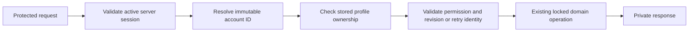

# Ownership, access control and retry identity — Phase 29.5

> Historical snapshot: the original phase dates, design decisions and recorded
> test results below are preserved. Statements about the then-current inventory,
> unavailable features and pre-authentication behavior are superseded by the
> [reviewed 2026-11-24 release snapshot](../backend/DEPLOYMENT.md#reviewed-release-snapshot-2026-11-24).
> This documentation change reruns no application tests and establishes no new
> Linux/Docker or browser acceptance.

Audited **2026-11-08**, using the complete current working tree on
`bhargav-frontend` at `f84099349d104e4e77c7080fba4465ca4e3470a4`.
This is an audit and future design, not an authentication implementation or a
penetration-test certification. No production source, dependency, environment,
student record, model, dataset or company requirement was changed.

## Conclusion and evidence boundaries

**No request currently establishes an authenticated student or checks an account's
ownership of a profile.** Knowing a profile ID permits reads and edits; knowing an
assessment ID exposes its linked profile ID and permits submission with that ID.
UUID randomness, claim confirmation, optimistic revisions, CORS and matching two
client-supplied IDs do not prove ownership. External deployment with student data
must wait for complete server authentication and authorization.

The new tests use two **anonymous** TestClient instances and synthetic identities
at `example.test`. They do not simulate authenticated Student A/B accounts. The
tests that expect anonymous access are characterization of a vulnerability; replace
those expectations with denial/owner-access tests in the implementation phase.
Scoring uses the real existing question bank and a fixed test-only clock. Prediction
values are explicitly stubbed for storage assertions, never claimed as model results.
Existing full-suite model tests separately execute the unchanged artifacts.

Evidence labels:

- **Demonstrated:** executed against the actual ASGI application in isolated storage.
- **Existing protection:** a successful negative/retry/preservation assertion.
- **Source finding:** traced in current code; no corresponding exploit claimed.
- **Potential risk:** plausible impact under stated deployment conditions, untested.
- **Proposed:** future design only; no route, session, owner or migration added.

Inspection covered all nine routers, generated OpenAPI, canonical/response schemas,
profile/session transactions, histories and shared projections, resume processing,
frontend API/profile/assessment/auth state, startup/environment settings and earlier
journals/policies. No actual student values were copied into this audit or test logs.

## Current identity architecture

| Mechanism | Actual behavior | What it establishes |
| --- | --- | --- |
| Resume draft | Successful `create_draft_with_analysis` generates `uuid4`; saves revision 1 and `verified=false` after extraction/analysis | Independent record identity only |
| Manual creation/confirmation | `verify_profile` generates a UUID if body ID is absent; also creates a new record using an acceptable client-chosen ID if it is absent in storage | Caller supplied claims, no ownership |
| Profile ID syntax | Letters, digits, hyphens and underscores; demo/human-readable IDs are allowed | Path safety, not mandatory UUIDs or authentication |
| Email/name | Stored claim strings; confirmation requires nonempty name/email; no verified email token, identity provider or account lookup | Neither address control nor historic ownership |
| Confirmation | `verified=true`; editable claims/provenance are accepted; protected history/evidence/originals come from the server | Claim review, not institutional verification or login |
| Existing-profile resume upload | Frontend calls read-only `/api/resume/analyze`; corrections use explicit PUT and confirmation | Retains selected ID/history; no automatic email merge |
| Repeated explicit creation | Each from-resume call or ID-less confirmation can create a separate profile | No account-bound deduplication |
| Selection/switching | `placepro_profile_id`, public `VITE_DEMO_PROFILE_ID` and `refetch(id)` select a record; browser state is mutable | UI selection, no permission |
| Revision | Server integer over claims/confirmation/provenance/assessment evidence; optional expected revision rejects stale conflicting edits | Freshness and local concurrency, no user identity |
| Assessment association | Stored session has `profile_id`; evidence is appended to that profile by assessment ID | Referential consistency; submit checks supplied ID equality |
| Prediction association | Explicit profile POST appends source inputs/revision and optional request ID to that profile | Record association; no authorized actor |
| History | Profile JSON contains assessment evidence and placement predictions; sessions retain original profile references; salary/direct placement are stateless | Original association, not a verified owner |
| Mock login/logout | Browser boolean `placepro_authenticated`; logout removes only that boolean from local/sessionStorage | Opens/closes UI only; no server session or revocation |

An arbitrary client can select another profile ID and call its API directly.
There is no profile-list/enumeration API; randomly guessing a UUID has not been
demonstrated. IDs can be obtained from browser storage, copied requests or session
responses; human-readable IDs also exist. The lack of an enumeration route limits
discovery, not authorization. Profile confirmation/email matching must never be
used to bind legacy records to an account.

## Complete endpoint authorization inventory

OpenAPI has **22 paths / 23 operations** (GET and PUT share a profile path).
Every application row currently has **AuthN: No / AuthZ: No**. Confirmation and
session/profile-ID matching are domain checks, not exceptions to that statement.
R means reads submitted input or stored data; W means changes application records;
H means exposes stored history ("derived" means assessment-derived evidence rather
than a complete history array). Local lock-file bookkeeping is excluded from W.

Future protection shorthand: **Owner** = active server session plus server-side
profile association on every request; **Session owner** = authenticate first, read
the session's association without lifecycle mutation, then check profile ownership;
**Account/quota** = authenticated account plus bounded parsing/inference; **Public**
= deliberately public, minimal output and bounded traffic. These are recommendations.

| Method | Path | Profile ID input | R | W | H | AuthN/AuthZ | Abuse scenario | Recommended protection |
| --- | --- | --- | --- | --- | --- | --- | --- | --- |
| GET | `/health` | No | Static | No | No | No/No | Traffic/liveness reconnaissance | Public; liveness only |
| POST | `/api/predict` | No, 16 form inputs | Input/model | No | No | No/No | Unbounded inference traffic | Account/quota, or deliberately limited public demo with no student context |
| POST | `/api/salary-predict` | No, form inputs | Input/model | No | No | No/No | Unbounded inference traffic | Account/quota; do not trust an extra client profile ID |
| POST | `/api/resume/upload` | No | Uploaded bytes | No persistent record | No | No/No | Parsing abuse; processing someone else's obtained document | Account/quota, upload and decompression/time bounds |
| POST | `/api/resume/analyze` | No | Uploaded bytes | No persistent record | No | No/No | Parsing abuse and extraction of supplied private text | Account/quota; Owner too if a future target profile is supplied |
| POST | `/api/profile/from-resume` | No | Upload/model-independent extraction | New draft | No, new arrays empty | No/No | Duplicate/unowned drafts and storage growth | Account, atomically bound ownership publication and creation key |
| POST | `/api/profile/verify` | Body ID optional | Body/existing profile | Create or replace/confirm | Yes, full profile response | No/No | Unauthorized edits/confirmation; client-ID squatting | Owner for existing ID; account creation path for new ID; editable-only body |
| GET | `/api/profile/{profile_id}` | Path | Full profile | No | Yes, originals/evidence/predictions | No/No | Private profile and source-input disclosure | Owner; private/no-store response; minimize projection |
| PUT | `/api/profile/{profile_id}` | Path/body must agree | Profile/body | Claims/confirmation/provenance/revision | Yes, full response | No/No | Replace another profile's claims, reset confirmation | Owner before save; require revision in authenticated client |
| POST | `/api/profile/{profile_id}/predict` | Path | Profile/model/history | Append prediction | Yes | No/No | Foreign history pollution and request-key replay | Owner before idempotency lookup; key bound to principal/resource/revision |
| GET | `/api/profile/{profile_id}/readiness` | Path | Confirmed profile/evidence | No | Derived | No/No | Disclosure of preparation/evidence gaps | Owner |
| GET | `/api/profile/{profile_id}/placement-summary` | Path | Profile/model/evidence | No | Derived, no history array | No/No | Private summary and inference traffic | Owner; quota; preserve read-only history behavior |
| GET | `/api/companies` | No | Company SQLite | First-use initialization/seed only | No | No/No | Traffic; expose future private metadata if carelessly added | Public sanitized demonstration/public requirements |
| GET | `/api/companies/{company_id}` | No | Company SQLite | First-use initialization/seed only | No | No/No | Traffic; metadata disclosure | Public sanitized output; any future company mutation needs separate staff role |
| GET | `/api/profile/{profile_id}/eligibility` | Path | Profile/companies/evidence | SQLite initialization only | Derived | No/No | Disclosure of academic/skill eligibility | Owner; public company data does not make student result public |
| GET | `/api/profile/{profile_id}/eligibility/{company_id}` | Path | Profile/company/evidence | SQLite initialization only | Derived | No/No | Targeted eligibility disclosure | Owner |
| GET | `/api/profile/{profile_id}/recommendations` | Path | Profile/model/companies | SQLite initialization only | Derived | No/No | Private rankings/gaps; inference traffic | Owner/quota; preserve demo labels |
| POST | `/api/assessment/start` | Body | Profile/session inventory/bank | Reservation plus expiry/recovery maintenance | No history array | No/No | Reserve foreign quota; duplicate lost-start retries | Owner, start request key, unchanged attempt policy |
| GET | `/api/assessment/{assessment_id}` | None; resolves stored ID | Session/profile inventory | May expire/recover sessions/evidence | Completed aggregate result | No/No | Linked-ID/result disclosure; foreign lifecycle maintenance | Session owner before any recovery/expiry; preserve public answer minimization |
| POST | `/api/assessment/{assessment_id}/submit` | Body compared with stored ID | Session/profile/answers/bank | Session/result/evidence/revision | Current result | No/No | Submit someone else's session using its disclosed profile ID | Session owner; supplied ID equality remains an additional consistency check |
| GET | `/api/profile/{profile_id}/assessments` | Path | Profile/session inventory | May expire/recover/repair active sessions | Yes, completed evidence | No/No | Foreign history disclosure and recovery side effects | Owner before lifecycle calls; history is completed evidence, not all reservations |
| GET | `/api/profile/{profile_id}/skills` | Path | Claims/latest evidence | No | Derived/latest timestamp | No/No | Disclosure of claimed and assessed skill state | Owner; evidence is not public proficiency |
| GET | `/api/profile/{profile_id}/performance` | Path | Profile/history/readiness | No | Yes, prediction inputs/results and assessment history | No/No | Bulk historical disclosure | Owner; minimize/paginate future histories |

Auxiliary framework routes are also unauthenticated: **GET/HEAD** `/openapi.json`,
`/docs`, `/docs/oauth2-redirect`, `/redoc`. They expose schemas/docs, not student
records; the OAuth redirect helper does **not** mean OAuth is installed. Restrict
or disable interactive docs in production if the deployment policy requires it;
that alone does not protect APIs. CORS handles OPTIONS preflight for any path with
the configured methods/headers; no separate business OPTIONS route is registered.
Unsupported HEAD requests on application GET routes are not additional endpoints.
No stored-resume download route, profile deletion route, account route, ownership
lookup/list route or company-modification route exists.

**Important side effect:** assessment GET/history call `_sync_sessions` for the
linked profile. A GET for one session can recover another accepted session for the
same profile. This behavior is intentional recovery, but authorization must run
before it. Other summary/projection GETs do not append prediction/assessment history.

## Demonstrated findings and existing protections

| ID | Finding | Evidence / impact |
| --- | --- | --- |
| D1 | Anonymous profile and history reads | Nine parametrized routes return 200; canonical/profile-performance expose synthetic contact, assessment evidence and prediction source inputs |
| D2 | Anonymous claim modification/confirmation | Second anonymous client edits email, resets confirmation, then confirms changed claims; no owner field/session is produced |
| D3 | Client-chosen creation and shared-email profiles | Two independent acceptable IDs with the same claimed email are confirmed without address control or account association |
| D4 | Session-ID disclosure enables matching-ID submission | Anonymous GET returns stored profile ID; second client supplies it and completes the session; completed aggregate result is also readable |
| D5 | Anonymous reservation interference | Three starts using the same unsupported idempotency header create ordinals 1/2/3; original client is blocked by 429 until slots expire |
| D6 | Foreign prediction/history actions | Second anonymous client replays a known key and obtains its result; a new key appends another record on the target profile |
| D7 | Retry gaps | Repeated ID-less confirmation/from-resume creates two IDs; unsupported headers do not deduplicate; unkeyed prediction creates two records |
| D8 | Unauthenticated GET can mutate lifecycle | After injected evidence-save failure, anonymous GET expires SQL reservation and recovers accepted Python submission exactly once |
| D9 | Open CORS and absent private cache policy | Untrusted Origin passes preflight; actual profile response reflects it with credentials allowed; no Cache-Control header |
| D10 | Error/validation information exposure | Synthetic invalid email input is echoed in 422; injected missing-model exception path is returned in 503 |

Existing protections exercised successfully: invalid path syntax rejection; supplied
profile mismatch returns 403 with both records preserved; stale conflicting PUT and
confirmation return 409; identical update does not advance twice; failed persistence
leaves prior bytes/revision; client history/evidence/originals/ML provenance cannot
overwrite server data; completed submission returns 409 with one unchanged result;
same prediction key deduplicates eight concurrent requests to one record; key scope
is separate per profile and changed revision returns 409; >128-character prediction
key is rejected; read-only analysis/stateless inference do not add history. Public
assessment responses omit answers, keys, explanations, `correct_ids` and internal
score reports while those values remain server-side. These are integrity/privacy
protections, not authenticated ownership.

Legacy PUT without revision remains accepted and can restore stale fields, as
demonstrated after a guarded rejection. This compatibility path is not a security
permission. An attacker can also fetch the latest revision; optimistic concurrency
cannot stop unauthorized edits. No raw stored answer leakage, UUID brute-force,
remote code execution, parser bomb, real-record exploit or penetration test is claimed.

## Threat model and severity

Assets: contact/education/context, extracted originals, claimed skills, assessment
questions/drafts/answers/results, prediction inputs/results, integrity of associations,
attempt quota and service availability. Actors: legitimate student, another API
caller with an obtained ID, an untrusted web origin, a shared-browser user, and a
local process with filesystem access. No staff authorization roles currently exist.
Trust boundaries: browser storage to API, API to JSON/SQLite, upload to parser,
history to current projections, and trusted model files to joblib loading.

Severity assumes the API becomes reachable by another person or browser origin.
The documented default is loopback and this audit ran in-process; remote deployment
reachability was not tested. Local-only development reduces exposure but creates
no ownership check. Ratings are qualitative, not calculated CVSS scores.

| Threat | Severity | Status and realistic consequence |
| --- | --- | --- |
| Access another profile/history using obtained ID | High | D1/D4; privacy breach of contact, assessments and source inputs; no enumeration/brute-force demonstrated |
| Edit/confirm another profile, replace confirmed claims | High | D2; loss of current claim integrity and downstream output changes; protected original history survives |
| Read another person's original binary resume | Not demonstrated | No retained-download endpoint; D1/D4 expose extracted originals instead; local temp/filesystem access remains a separate risk |
| Take another person's assessment/read their result | High | D4; matching IDs permit scored attribution without authenticating the participant |
| Reserve quota or trigger cooldown against another profile | Medium to High | D5 reserves bounded slots; a scored foreign attempt can consume quota/cooldown; no attempt policy bypass demonstrated |
| Reuse wrong session/profile association | Existing protection | 403 mismatch; matching target IDs bypass caller identity because it is absent |
| Replay completed assessment | Existing protection | 409 and unchanged evidence; GET reconciles accepted result; no extra score from replay |
| Add/replay foreign placement history | High | D6; association remains target profile but actor is unknown; raw history writes from PUT are protected |
| Lost creation/start response and repeated network retry | Medium | D7; independent drafts or up to three reservations; original start is not discoverable from completed history |
| Stale/concurrent profile writes | Medium | Guarded 409/local locks protect cooperating clients; omitted revision demonstrated to permit stale replacement |
| Unbounded uploads/inference/history growth | Medium | Source risk: no account/IP rate limit, total quota or history retention; 5 MB/25-question limits do not bound total work; no load/ZIP-bomb test |
| Untrusted browser origin | High amplifier | D9 permits arbitrary Origin; CORS is not authorization, and non-browser callers do not obey it |
| Shared browser/script reads local caches; logout retains data | Medium | Source finding: profile/draft/answer storage remains after mock logout, and provider fetches before login |
| Error/log/path and invalid-input disclosure | Low to Medium | D10 synthetic demonstration; no actual private record leakage sampled |
| Direct filesystem access or substituted pickle | High conditional | Local ACL/trusted-artifact boundary; not an HTTP exploit; no model path/upload selection route and no RCE demonstration |

## Proposed ownership and authentication model

**Decision:** use a server-side opaque session delivered in a Secure HttpOnly cookie
for this first-party React/FastAPI application. The server session establishes a
stable account ID; a separate server-controlled account-to-profile association
authorizes resources. JWTs are unnecessary for the current single backend/browser
topology. These decisions do not install a session or account package today.

### Account and profile association

- New accounts have a server-generated immutable `user_id`, status and credential/
  provider record. A contact claim on a profile is independent of account identity.
- Allow multiple **deliberately created** profiles per account because independent
  records already exist. Keep an optional primary-profile preference; switching is
  limited to profiles returned by an owned-profile API. Re-upload updates/reviews
  an explicitly selected owned record; do not deduplicate by email or name.
- A new profile is linked to the authenticated account before becoming accessible.
  Owner fields are never accepted from the editable body. An authoritative ownership
  registry can keep account metadata separate without rewriting historical JSON.
- Existing records without an association are **unowned**, denied to ordinary
  authenticated callers. Neither `verified=true`, UUID possession nor verification
  of a matching email today proves historic ownership. No legacy bypass may remain
  on protected routes. Claiming requires separately approved out-of-band institutional
  evidence and reviewed mapping/conflict handling.
- Default student permissions are own-profile read/edit/confirm/predict and own-session
  lifecycle/history. Sharing/mentor/staff roles require explicit scoped grants and a
  separate requirement; do not infer them from email domains or browser labels.

Every protected request must: validate the server credential -> load active user ->
validate target ID -> read authoritative ownership association -> check permission ->
perform domain/revision/idempotency checks under existing record locks -> return a
minimal private result. Session routes resolve their stored profile link before
domain recovery. Missing/foreign objects use a consistent 404 after authentication
to avoid existence disclosure; absent/expired/invalid authentication returns 401;
CSRF or a known disallowed action returns 403. Revision/idempotency conflict remains
409; validation/cooldown/expiry retain domain codes. Denial must cause no record,
history, expiry or recovery mutation. Authenticate before looking up a replay result.



### Session and credential lifecycle

Production cookie proposal: `__Host-placepro_session`, random 256-bit opaque value,
`Secure`, `HttpOnly`, `Path=/`, no Domain and SameSite=Lax (Strict if the approved
navigation/provider flow permits it). Store a hash of the token and user/expiry/
revocation metadata server-side; no profile or password data in the cookie. Rotate
on login/recovery/privilege changes, enforce proposed 30-minute idle/12-hour absolute
expiry, and invalidate server-side on logout. These time limits are design proposals
to confirm before implementation. Do not implement persistent "remember me" until
its revocation/re-authentication requirements are included.

Prefer one HTTPS origin with `/api` routing in production. Development needs an
explicit localhost/loopback origin policy and consistent hostname; cookies are not
isolated by port. If distinct origins are retained, use an explicit allowlist and
credentialed fetch, with correct SameSite/HTTPS behavior. Do not copy current wildcard
CORS into a cookie-authenticated deployment. Unsafe requests, login and logout need
CSRF protection: session-bound token in a custom header plus Origin/Referer checks;
SameSite/CORS alone are insufficient. CSRF rejection must precede idempotency mutation.

Registration/login must be a complete account flow, not a replacement boolean. If
institutional OIDC is actually available, prefer provider-managed credential/recovery
with validated issuer/audience/signature/state/nonce and authorization-code PKCE,
then issue the same application server session. No provider is currently configured.
Otherwise plan local registration, address verification and approved mail delivery,
Argon2id password hashes with benchmarked costs, passphrase-friendly input without
silent truncation, generic login/recovery responses, rate limiting and single-use
hashed, short-lived recovery tokens. Address verification controls that account's
address only; it cannot automatically claim old profiles. Account recovery revokes
old sessions and requires re-authentication for sensitive changes. Passwords/tokens
must never enter logs, profile JSON or VITE variables. No credential dependency was
added in this phase.

### Options and trade-offs

| Option | Advantages | Costs / decision |
| --- | --- | --- |
| Opaque server session + HttpOnly cookie | Immediate expiry/revocation/logout; small browser credential; simple account lookup | Server lookup, CSRF and session store required; selected design |
| JWT bearer in memory | Useful for multiple services/non-browser clients; no automatically attached cookie | XSS can act as/exfiltrate bearer; exp/signature/issuer/audience/algorithm checks and revocation policy; still check ownership server-side |
| JWT in HttpOnly cookie | Prevents JS reading token; browser delivery | Still CSRF; JWT claims are readable, not encrypted; revocation/recovery remains stateful; no current simplification |
| Short access JWT + rotating refresh cookie | Short exposure window and long sessions | Token-family/reuse detection, concurrency/recovery, revocation and CSRF complexity; defer until clients/deployment require it |
| Starlette signed cookie SessionMiddleware | Convenient signed browser session | Signing is not encryption or an opaque server-side revocation store; not sufficient alone for selected ownership/session lifecycle |

If JWT is later adopted, allow only configured signing algorithms and validate
signature/issuer/audience/exp/nbf and active account status. Never put owner permission
solely in a client-chosen profile claim or stale token. Refresh rotation must handle
concurrent legitimate requests and family replay deterministically. HttpOnly limits
token reading, not XSS actions; retain output escaping and a reviewed CSP policy.

## Current retry and idempotency inventory

| Operation | Retry/idempotency behavior | Duplicate/lost response | Revision association |
| --- | --- | --- | --- |
| Confirmation without ID / new manual creation | No request identity; unsupported key has no effect | Lost response cannot discover generated ID; repetition creates another record | New revision 1 |
| Confirmation with known ID | Full-body exact replay can return existing state; stale differing guarded request 409 | Can recover by known-ID GET; omitted revision can overwrite newer claims | Optional reviewed revision; confirmation can advance |
| From-resume creation | No key/fingerprint/email ownership; each call generates UUID | Lost response strands unselected draft; retry duplicates; no list/discovery | New revision 1, unconfirmed |
| Resume upload/analyze | Re-executes parsing, no persistent profile | No profile duplication; cannot recover prior preview, can parse again | No target revision; frontend comparison is read-only |
| Profile PUT | Local lock + optional expected revision; identical repeat is harmless | Known ID reload reconciles; failed save preserves prior bytes; a later change can make retry conflict | Guarded if supplied; legacy omission weaker |
| Assessment start/reserve | Per-profile/skill quotas and unique ordinals, no start key | Three repetitions can reserve three slots; lost start has no active-session discovery API | Stored session has profile ID/timing, **no source_revision** |
| Assessment submit | Existing session ID + accepted SUBMITTING report/evidence deduplication | Completed replay 409; GET recovers same report; interrupted same accepted answers can recover; no second score/evidence | Evidence advances profile revision once, session has no source revision |
| Profile placement prediction | Optional `Idempotency-Key`, max 128 chars, lookup within profile history | Same key/current revision replays; changed revision 409; unkeyed/new-key calls append; lost keyed response recoverable with key | New entries store revision and mapped inputs; no owner/payload/model-version fingerprint or TTL |
| Direct placement | Stateless inference; no idempotency ledger | Repeat recomputes but creates no history; original response not recoverable as a stored result | Frontend submitted input/profile stamp only |
| Salary | Stateless inference; no ledger/history | Repeat recomputes, no persistent duplication | Frontend input/profile stamp only |

Frontend in-flight guards prevent repeated clicks within one controller; they do not
provide cross-tab/network/server idempotency. API services supply neither real auth
credentials nor start/create request keys. Form placement calls `/api/predict`, not
the history-writing endpoint. Existing profile prediction replay is profile-scoped,
not account-scoped: different profiles may reuse a key, but any caller knowing the
target can replay it. Raw request IDs are returned in canonical/history responses;
they are identifiers, never secrets or authentication tokens. Model-version change
without profile change is not checked on replay. Histories/keys have no TTL and lookup
is linear. Legacy source revisions remain unknown and are not retroactively assigned.

### Proposed consistent retry strategy

1. Client generates a random request UUID **once per deliberate mutation**, before
   transmission, and retains it until success/reconciliation. Network retry reuses
   it; new intent creates a new key. Keys contain no email/profile claims/secrets.
2. Server binds identity to `(authenticated user_id, operation, resource_id, key)`.
   Creation scopes resource to the account until an ID is reserved. Authenticate
   and authorize before lookup, even on replay; an identical key from another
   account cannot retrieve the first account's result or evade a foreign-resource
   denial. Existing per-profile scoping alone is inadequate.
3. Fingerprint normalized **effective** input, operation/API version and expected
   source revision. For uploads include a server-computed digest of file bytes;
   exclude untrusted owner/history fields. Keep digest private (keyed HMAC where
   appropriate), do not return it or use it as cross-account deduplication. Same
   key/different payload returns 409 without executing a new action.
4. Reserve stable resource identity and record states such as PENDING, ACCEPTED,
   APPLIED and UNKNOWN under a unique constraint/lock. Same-scope concurrent calls
   have one executor; others get the completed response/reference or an explicit
   pending status/Retry-After, never a second reservation.
5. Preserve domain contracts: expired start key cannot start again (410, new intent
   required); completed submit can retain 409 plus owned GET reconciliation; profile
   prediction key from an older revision retains 409. Returning a prior creation
   reference never restores its old profile values; fetch current owned state.
6. Store minimal result/reference/status, accepted revision/inputs and model version
   where relevant. Existing assessment ID is already a natural submission identity;
   do not add a second competing scoring/evidence source. Stateless inference does
   not require durable idempotency unless billing/history is added.
7. Proposed retry retention: seven days for creation mappings; session deadline plus
   24 hours for start reconciliation; preserve completed submission identity with
   its existing record. Bound short-lived response caches separately. Keep unresolved
   accepted/UNKNOWN work until reconciled. Exact TTLs need product/privacy approval.
   Retired keys should return explicit expiry while a minimal tombstone exists;
   beyond retention no indefinite deduplication guarantee is possible. Clients must
   stop automatic retries beyond the supported window and reconcile before new intent.

**Storage compatibility:** no ledger/storage change is implemented now. In the
future, existing stdlib SQLite capability can support a small dedicated account/
ownership/session/idempotency metadata store, separate from the public company DB;
alternatively cooperating JSON record locks can host bounded metadata for a strict
single-host deployment. Do not introduce a new database technology solely for retries.
Select one authoritative mapping/ledger, not copies in localStorage and profile JSON.

SQLite metadata plus existing profile/session JSON still cannot make a crash-atomic
cross-file transaction. Use a stable reserved target ID and durable accepted intent;
keep ownership/new resources inaccessible while PENDING, publish only after JSON and
association are durable, and reconcile under existing locks without a second ID or
score. On uncertainty return a retriable error/pending state, not success. Test
failures before/after each write and restart recovery. Stronger guarantees would
require a separately approved storage transaction/migration phase, not an assumption.

## Privacy and data handling

| Location | Current contents/protection | Finding and future policy |
| --- | --- | --- |
| Profile JSON | Contact/education/skills, age/gender/attendance and other optional context, originals/provenance, assessment evidence and prediction inputs/results; Git-ignored | No API owner restriction, record encryption or implemented retention/account lifecycle; use restricted service ACL and disk protection; minimize collected context |
| Resume processing | 5 MB PDF/DOCX, magic/extension validation; random temp path; TemporaryDirectory removes **new** upload file on exit; raw text preview up to 500 chars and provenance snippets returned | No stored binary-download endpoint; extracted originals remain private data; add parser decompression/time/output limits and sensitive-temp policy; never clean existing scratch/backups in this phase |
| Assessment JSON | Questions including keys/explanations, accepted answer text, score report/correct IDs, profile ID and timing | Public response omits these secrets but lacks caller authorization; restrict filesystem and session routes; retain only justified scoring/audit data |
| Prediction history | Source inputs/revision, probability/label/version/time/key | Canonical/performance/prediction responses expose history; retain provenance while separating current results; add owned paginated history/minimal response projections |
| `placepro_profile` localStorage | Flattened contact, education, ML values and counts | Persistent same-origin JS/shared-browser exposure; prefer in-memory server-derived profile, remove sensitive mirrors in future lifecycle |
| `placepro_resume_draft` localStorage | Full pending canonical draft and originals | Persists private extraction beyond page session; future minimal request/reference storage and bounded draft retention |
| `placepro_profile_id` / public VITE default | Client-selected ID | No credential; owned profile picker/list must replace unrestricted selection |
| Assessment sessionStorage | Backend/profile-scoped session ID, selected answer indices, pending delivery metadata | No official score, but private answer draft; remains after logout until tab closes; clear on future logout/expiry/account switch |
| Mock authentication flag | Browser boolean; no real password/token stored by this service | Can be changed locally; never treat as server permission; provider loads profile before mock login |
| Logs/errors | Standard access logs can include path IDs; 422 can echo invalid input; raw caught exceptions can return paths | D10; future sanitized validation errors, stable diagnostic codes/request correlation IDs, restricted/redacted server logs; no passwords/tokens/answer bodies/profile payloads |
| HTTP caching | Profile response has no explicit private/no-store header; assessment frontend requests use no-store | Future server `Cache-Control: private, no-store` for all private outputs; logout cannot recall earlier downloads; no claim that a cache leak was demonstrated |
| CORS/transport | All origins/methods/headers, credentials enabled; default HTTP loopback | Actual Starlette 1.6 reflects any Origin; explicit HTTPS deployment origin policy and real auth/CSRF required |
| Local temp/backups/scratch | Prior validation evidence and crash temp files are intentionally retained | No existing contents inspected/disclosed or deleted here; future approved access/retention and backup lifecycle, not automatic cleanup |

No unsafe HTML insertion was found in the inspected frontend paths; that is not an
XSS certification. HttpOnly does not prevent injected script making authenticated
requests. Profile previews/originals sent to an authorized browser still require a
privacy justification; authentication does not make excessive retention harmless.

Future retention proposals, **not applied**: successful resume binaries deleted after
processing (existing behavior); rejected/new temporary upload cleanup on exit;
pending draft/retry references expire after seven days; short redacted operational
logs around 30 days; assessment answers retained only for an approved review window
while minimal result/provenance retention follows institutional policy. Define
student export, deletion request, account deactivation, session revocation, legal
holds and backup expiry together. An account deletion must not silently orphan or
erase history. Notify/approve irreversible deletion and document recovery/hold rules;
no actual records are deleted or anonymized by this audit.

## Future implementation roadmap and migration safeguards

Recommended next assignment: **Phase 29.6 — Complete authentication and ownership
enforcement**, subject to a separate user assignment and acceptance of this design.
No 29.6 work starts here. Implement as one release gate with staged internal work:

1. Confirm first-party HTTPS/host policy, credential provider/local registration,
   recovery delivery, metadata authority, permission matrix and retention window.
2. Implement complete account/session/CSRF/revocation flows and reusable FastAPI
   current-user/owned-profile/owned-session dependencies. Protect all private routes
   together, including lifecycle GETs, mutation responses and replay results. Reject
   spoofed owner fields; keep public company/health outputs deliberate.
3. Bind new profiles safely; expose owned profile selection; bootstrap profile only
   after session confirmation. Centralize API credentials/401/403 handling, abort
   outstanding requests on logout/expiry/account switch, clear private mirrors/drafts/
   answers and notify other tabs. Do not replay unsafe POSTs automatically after login.
4. Add principal-bound create/start retry identity and owned discovery with durable
   recovery, preserve existing submit/prediction contracts, and enforce per-account
   parsing/inference quotas. Include concurrent/failure/expired-key scenarios.
5. Enable release only after the denial matrix, credential/recovery/CSRF and retry
   tests below pass. No half-protected endpoint subset or frontend-only auth switch.

**Separate approved legacy ownership plan:** existing profile IDs and historical
session/evidence/prediction references stay unchanged. Inventory only necessary
metadata privately; establish ownership via approved institutional evidence; review
an explicit account-to-profile mapping, conflicts and orphan policy; obtain explicit
approval with restricted backup/rollback and audit trail; then add associations
without merging histories. A later record consolidation would need its own explicit
migration plan and approval. Do not backfill invented revisions/owners or use
email-only automatic claiming. No schema/data migration occurs in Phase 29.5.

## Testing strategy and actual validation

Future acceptance matrix: anonymous/invalid/expired/revoked credentials denied on
every protected method; owner allowed; other account denied even with valid UUID,
matching email/claim confirmation, latest revision, assessment IDs and keys; no side
effects from denied lifecycle GETs. Test disabled accounts, login fixation, logout,
CSRF/Origin checks, reset token reuse/expiry, rate limits, browser storage/account
switch, no credential/PII error leakage, foreign idempotency key isolation, payload
conflicts, deadlines/cooldown, concurrent creates/starts/submits/predictions and
failure/restart reconciliation. Keep real records/artifacts out of mutable fixtures.

Executed from the root with existing CPython 3.14.6, pytest 9.1.1 and the unchanged
environment; pytest binds new storage before collection and per test. Full suite
owns its own HTTP child at `http://127.0.0.1:64304`, never an existing server.

```powershell
git diff --check
```

The runner expands to `python -B -m pytest <selection> -q -p no:cacheprovider` and
retains command arguments/output/exit. It performs no production storage mutation.

| Execution | Passed | Failed | Errors | Skipped | Deselected | Warnings | Result |
| --- | ---: | ---: | ---: | ---: | ---: | ---: | --- |
| Initial focused characterization | 32 | 1 | 0 | 0 | 0 | 0 | Exit 1; 30.60 s; incorrect new CORS assertion |
| Final focused audit | 35 | 0 | 0 | 0 | 0 | 0 | Exit 0; 7.19 s |
| Full backend (includes focused and all six existing live-HTTP cases) | 582 | 0 | 0 | 0 | 0 | 10 | Exit 0; 54.36 s |

Focused 35 are included in 582; do not sum runs as unique coverage. The ten retained
joblib/NumPy shape-assignment deprecations occur on original model loading in
`test_integration.py`; no suppression, package upgrade, training or artifact resave.
Initial CORS expectation was corrected after reading installed middleware: with
wildcard origins and credentials it reflects the supplied Origin in both tested
responses. The first standalone inventory command failed `ModuleNotFoundError:
backend` because a scratch script was not on the root import path; adding the root
to this **new audit helper** fixed it. No application source was changed for either
harness issue. Earlier outputs remain evidence, not final passes.

Frontend source/tests were unchanged; Node/lint/build/browser were not rerun in
this backend audit. Phase 29.4 frontend/browser results remain historical evidence,
not new security coverage. No network penetration/load test or real-user exploit. New files: `backend/tests/test_ownership_access_audit.py`, this document. All earlier work/backups are preserved.

## Final repository preservation

Branch remains `bhargav-frontend`, HEAD
`f84099349d104e4e77c7080fba4465ca4e3470a4`, with an empty index. Final working tree: **56 modified tracked files + 56 grouped untracked entries =
112 entries**, **73 expanded untracked files**. All 111 initial Git entries remain. The historical phase changed only its two audit files and recorded documentation; production
backend/frontend files, dependencies and existing tests retain their phase-start
bytes. All 558 data/model/ML-source files and six environment/backup files retain
their captured hashes. Earlier journal bytes remain intact and no baseline file
was deleted. The owned test port 64304 is available after fixture shutdown.

Scratch evidence is
ignored and retained. No authentication, record migration or later phase started.

## References and source anchors

- Current `backend/app/routes/*`, `schemas_profile.py`, `schemas_assessment.py`,
  `services/profile_service.py`, `assessment_service.py`, `storage_lock.py`,
  `resume_service.py`, `performance_service.py` and `main.py` establish behavior.
- Frontend `services/auth.js`, `api.js`, `profileState.js`, `assessmentSession.js`,
  `profileConfig.js`, `hooks/useProfile.js` and `App.jsx` establish UI/transport/cache
  behavior. README and evidence/revision/integration policies retain earlier decisions.
- [FastAPI security dependencies and JWT/password tutorial](https://fastapi.tiangolo.com/tutorial/security/oauth2-jwt/)
  and [scopes](https://fastapi.tiangolo.com/advanced/security/oauth2-scopes/), retrieved
  through Context7; the tutorial is an API mechanism, not this ownership solution.
- [Starlette 1.6.0 SessionMiddleware](https://github.com/kludex/starlette/blob/1.6.0/docs/middleware.md),
  retrieved through Context7: signed session data is readable; cookie flags alone
  do not implement server-side ownership or revocation. Installed CORS source was
  read directly to verify the actual reflected-origin behavior.

The audit remains a record of **missing** authorization until a complete future
implementation and denial matrix are delivered. No authentication, migration or
later phase is claimed complete by these passing characterization tests.
