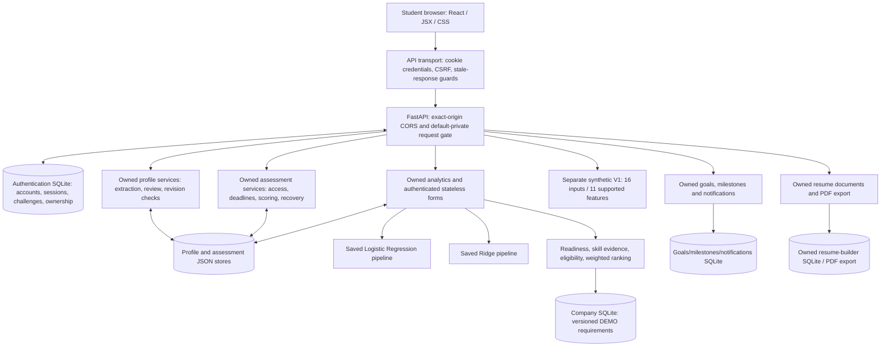
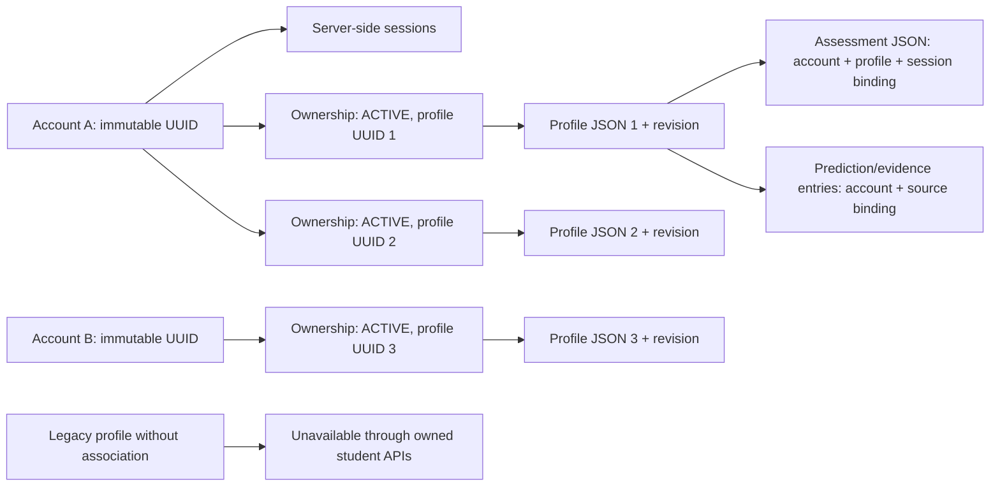
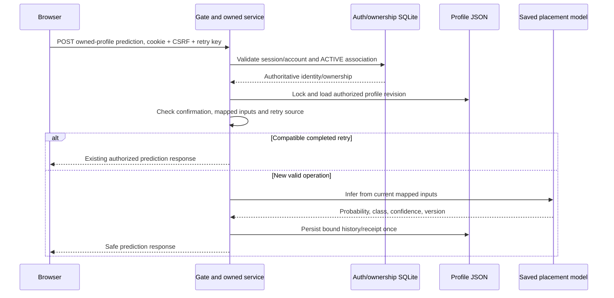
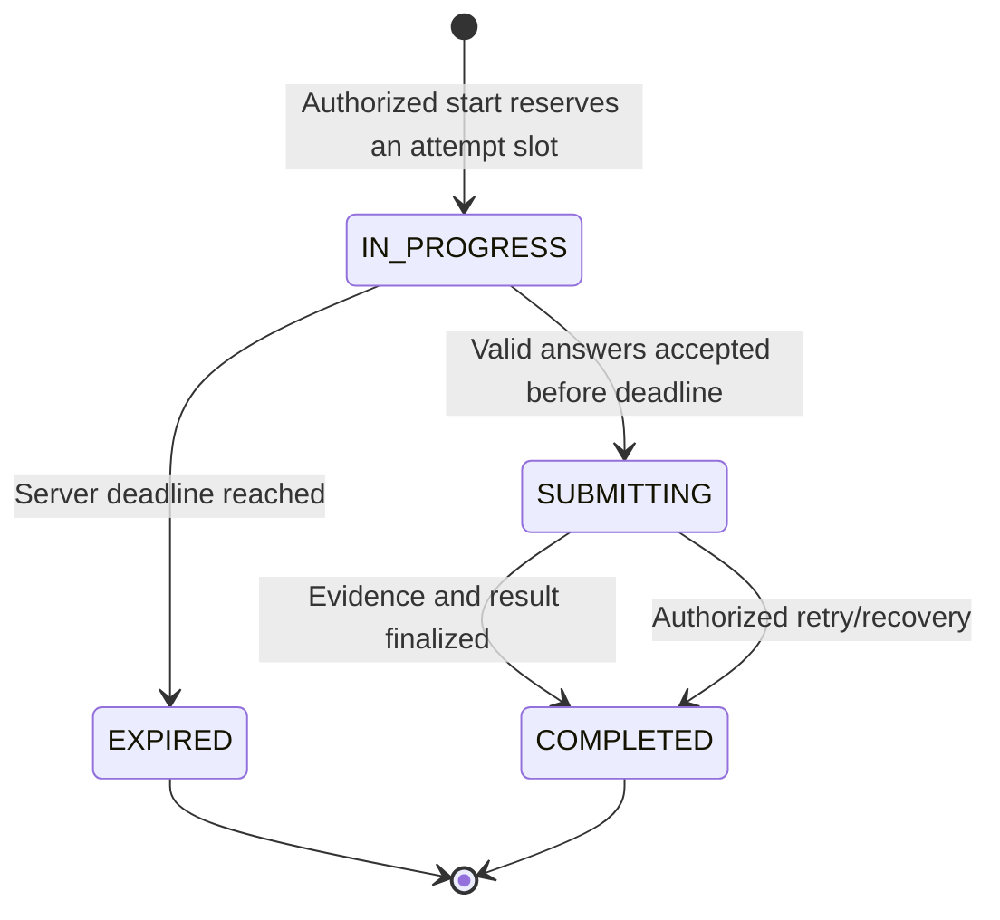

# PlacePro — actual system architecture

> Publication refresh (2026-11-24): current capabilities, 50 operations/45 paths,
> required artifacts and verification boundaries are summarized in the
> [reviewed release snapshot](../../backend/DEPLOYMENT.md#reviewed-release-snapshot-2026-11-24). Earlier dated results remain historical;
> no new application tests, browser acceptance or Linux/Docker success are claimed.

Audit date: 2026-11-09. Source inspection and read-only artifact/CSV/route inspection
support this document. No application code, records, models or schemas were changed.
See [project explanation](project-overview.md) and [limitations](limitations-and-future-scope.md).

## Component diagram

This is a local modular application, not a microservice deployment. Uvicorn serves
the FastAPI ASGI application; the isolated local harness supplies a Vite development
server, while public frontend hosting uses the guarded production build.
Normal requests use saved estimators. Training scripts are separate and must not
run during a presentation or this preparation audit.

## Source responsibilities

| Location | Actual responsibility |
| --- | --- |
| `frontend/src/App.jsx` | Session-aware application and state-based page switching; account/profile workspace remount. |
| `frontend/src/hooks/StudentProfileProvider.jsx` and `useProfile.js` | Shared selected profile, owned-list selection, draft/revision refresh. |
| `frontend/src/services/auth.js` and `apiTransport.js` | Login challenge, cookie fetch, CSRF memory, expiry/logout and request-generation checks. |
| `frontend/src/services/profileState.js`, `retryIntent.js`, `assessmentSession.js` | Stale response/draft controls and account/profile-scoped retry/assessment controller behavior. |
| `backend/app/main.py` | Constructs services, installs secured routers, CORS and the private gate. |
| `backend/app/security.py` | Public/entry/session/profile/assessment/analytics classification, authentication and CSRF/Origin ordering. |
| `backend/app/routes/owned_*.py` | Private transport checks, schema-safe requests and non-disclosing responses. |
| `backend/app/services/owned_*.py` | Authoritative profile/account/session/result access, revision and side-effect ordering. |
| `account_store.py`, `session_store.py`, `ownership_store.py` | Authentication SQLite integrity and transactional resource associations. |
| `profile_service.py`, `assessment_service.py`, `storage_lock.py` | JSON domain persistence, local cooperating locks, lifecycle and recovery. |
| `src/pipeline.py` | Exact placement input/feature engineering/preprocessing and saved classifier inference. |
| `salary_prediction_service.py` | Shared-request conversion, feature support guards and saved salary regressor inference. |
| `experimental_v1_service.py`, `experimental/v1/feature_schema.py` | Separate synthetic classifier, 16 validated inputs and 11 supported inference features. |
| `goals_service.py`, `goals_store.py` | Owned goals/milestones and notification persistence. |
| `resume_builder_service.py`, `resume_builder_store.py` | Owned resume documents, revision-protected save/import and generated PDF export. |
| `readiness_service.py`, `skill_evidence.py`, `eligibility_service.py`, `recommendation_service.py` | Explicit evidence and rule-based analytics. |
| `scripts/demo.py` | Fresh-only local synthetic provisioning, owned Vite development server, secured API startup and owned shutdown. |

The frontend uses React Context/hooks rather than Redux. Navigation uses the existing
URL mapping/History API and page state without React Router. References in browser storage help restore
selection/assessment drafts; they do not authenticate an account or authorize a profile.

## Storage and relationships

| Store | Default application location | Main content |
| --- | --- | --- |
| Authentication SQLite | `data/auth/accounts.sqlite3` | Accounts, sessions, login challenges, profile ownership. |
| Company SQLite | `data/companies.db` | Companies, versioned requirement sets/fields and provenance. |
| Goals SQLite | `data/goals/goals.sqlite3` | Owned goals, milestones and notifications. |
| Resume-builder SQLite | `data/resume_builder/resume_builder.sqlite3` | Owned resume documents and revisions; PDFs are generated responses. |
| Profile JSON | `data/profiles/` | Canonical sections, revision, confirmation, provenance, original extracted resume values, prediction history and assessment evidence. |
| Assessment JSON | `data/assessments/` | Assessment/account/profile IDs, ownership metadata, attempt, selected questions, timing, lifecycle and accepted submission/report. |
| Placement artifact | `models/placepro_final_model.pkl` | FunctionTransformer → ColumnTransformer → LogisticRegression. |
| Salary artifact | `models/placepro_salary_model_v2.pkl` | ColumnTransformer → Ridge. |
| Experimental V1 artifact | `experimental/v1/placepro_v1_production_fields.pkl` | Separate synthetic StandardScaler/OneHotEncoder/LogisticRegression pipeline. |

The isolated demo replaces these store paths only in its child/build environment
with a new temporary `placepro_demo_*` workspace. The production container uses
the reviewed `/var/lib/placepro` volume paths in the deployment guide. The demo uses existing schemas, not
historical database migrations. Models remain read-only project artifacts.

In authentication SQLite, `accounts.account_id` is the account primary key;
normalized email is unique but is not profile-claim authority. Sessions reference
accounts by foreign key and store secret hashes, lifecycle and revocation metadata.
`profile_ownership.profile_id` is unique/primary, with an account foreign key,
status, association version, UTC timestamps and creation digest. An immutable
identity trigger prevents reassignment through ordinary updates. Status values
are PENDING, ACTIVE, FAILED and SUSPENDED. Only ACTIVE grants profile access.

Profile creation reserves PENDING ownership, writes a new server-ID JSON profile
without overwrite, validates it, then activates ownership. Failure leaves pending/
incomplete records inaccessible; it does not delete or claim historical records.
This publication protocol is not one distributed atomic transaction.

## Request execution order

For protected operations:

1. Check the route's security classification and transport/origin policy.
2. Resolve a valid server-side session and ACTIVE account.
3. Validate required CSRF/Origin, including lifecycle GETs.
4. Establish ACTIVE profile ownership and, where applicable, assessment/result binding.
5. Recheck identity/ownership under resource acceptance/locks as appropriate.
6. Validate profile revision, retry payload and lifecycle conditions.
7. Perform authorized inference, mutation or result retrieval.

Stateless placement/salary forms have no stored profile target, so steps 4–6's
resource-specific conditions do not apply; authentication and CSRF/Origin still do.
Account IDs and ownership are obtained from validated server identity, not client input.

UUID secrecy, UI hiding and CSRF are each insufficient substitutes for ownership.
CSRF protects a logged-in browser from unwanted request initiation; ownership
checks which student resource the authenticated account may operate on.

## Assessment lifecycle: stored states versus policies

RESERVED, COOLDOWN and RETAKE are useful workflow concepts, not extra stored
assessment status strings. Start persists IN_PROGRESS and reserves quota. Cooldown
is an eligibility rule after scored completion; a retake creates another attempt.
Submission receipts/recovery preserve once-only evidence; a completed duplicate
returns 409 while its official result remains readable. Expiry does not award a score.
Both assessment GET and profile assessment-history GET can expire/recover records,
which is why CSRF/Origin is required for them despite using GET.

## Model and rules boundaries

| Result | Mechanism | Interpretation |
| --- | --- | --- |
| Placement probability/class | Logistic Regression after feature engineering/preprocessing | Estimate for the model's placed label; no verified real-world calibration claim. |
| Model class confidence | `max(p,1-p)` | Same probability calculation, not accuracy. |
| Annual salary | Ridge after service mapping and preprocessing | Conditional estimate, not guaranteed offer or prediction interval. |
| Readiness | Evidence-based weighted rules | Preparation score; not ML accuracy. |
| Eligibility | Mandatory PASS/FAIL/UNKNOWN checks | Result against configured DEMO requirements. |
| Recommendations | Five-component weighted heuristic plus eligibility override | Ranked matches; not learned hiring probability. |
| Assessment score | Difficulty-weighted correct points | Performance on the selected practice questions. |

The production placement pipeline's numeric/categorical transforms are fitted
objects stored with the classifier. Deterministic feature engineering adds 10
features to 16 raw columns before preprocessing. The salary pipeline uses 10
numeric and 2 categorical inputs, with imputation and categorical one-hot encoding.
Unlike the placement numeric pipeline, the inspected salary numeric pipeline does
not include StandardScaler. Different feature scales/categories need explicit mapping.

## Complete application operation inventory

Current production route discovery verified 50 operations and 45 paths. “Entry”
means a login/registration initiation endpoint, not access to student data.

See [the complete current method/path inventory](../../backend/DEPLOYMENT.md#reviewed-release-snapshot-2026-11-24) for all 50 operations.
It includes the existing profile/resume preview and builder, assessment, analytics,
V1, goal/milestone, notification, authentication/OAuth and two deferred standalone
resume operations. Existing access-policy differences remain authoritative.

Anonymous private operations receive 401; required security failures receive 403;
foreign/missing/legacy owned targets are concealed with 404. Genuine storage failures
can return safe 503 instead of pretending a resource is simply missing. Unknown
routes remain private by default. See existing [security validation](../phase-29-security-validation.md)
and [prediction ownership](../prediction-ownership.md) for detailed error policies.

## Concurrency, retries and deployment limits

SQLite constraints/transactions protect association uniqueness; per-profile thread
and OS file locks protect cooperating JSON operations on one host. Profile revisions
implement optimistic editing: a stale reviewed revision is rejected instead of
silently overwriting a newer edit. Retry identities bind account, operation, target
and compatible payload/source as appropriate. A retry key alone never authorizes access.

There is no shared atomic transaction across authentication SQLite and student
JSON, no multi-host coordination, and no certified power-loss/network-filesystem
guarantee. Pending publication remains quarantined; keys lack TTL cleanup. The
architecture supports the inspected local demonstration, not a claimed scalable
public deployment. These are explainable boundaries, not reasons to alter the
project during its documentation-only preparation phase.
